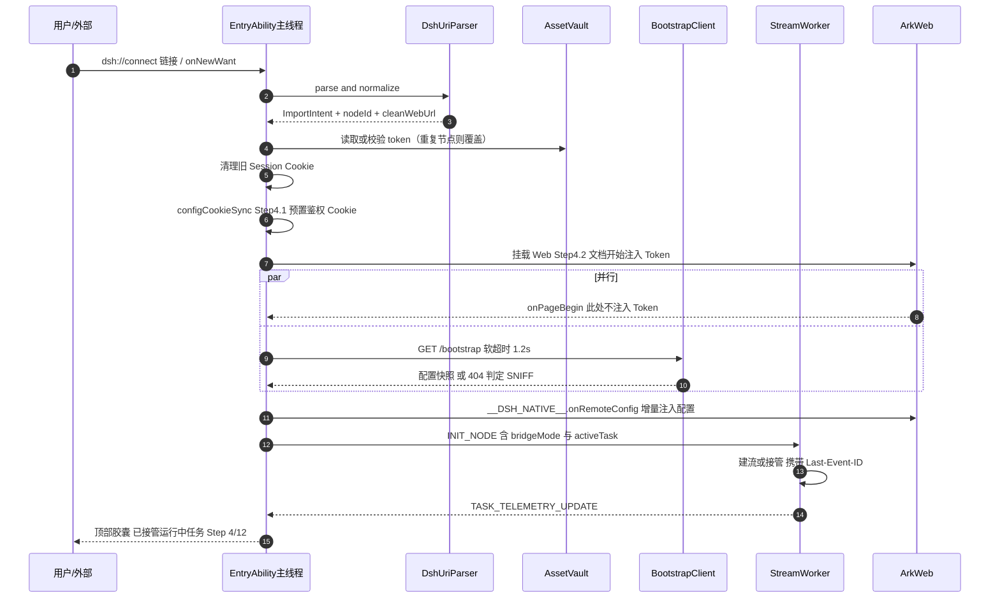
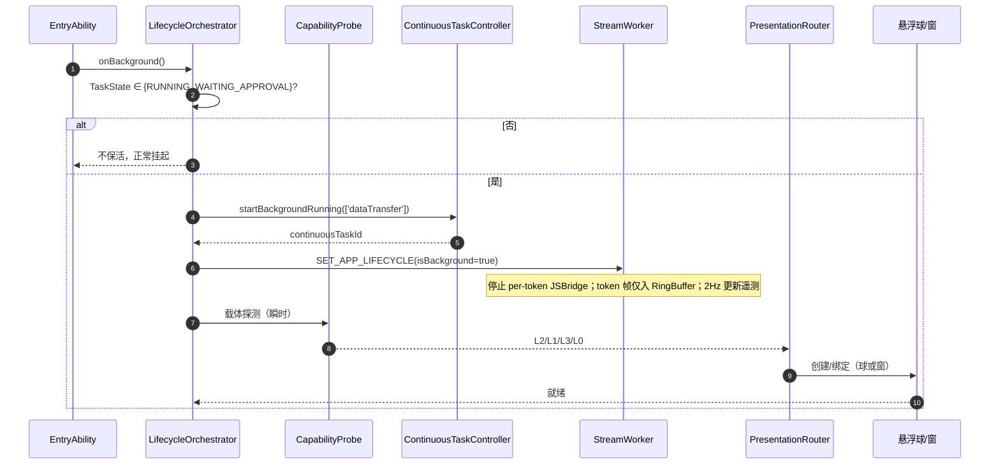
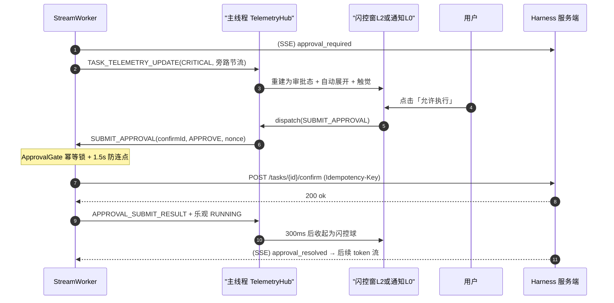
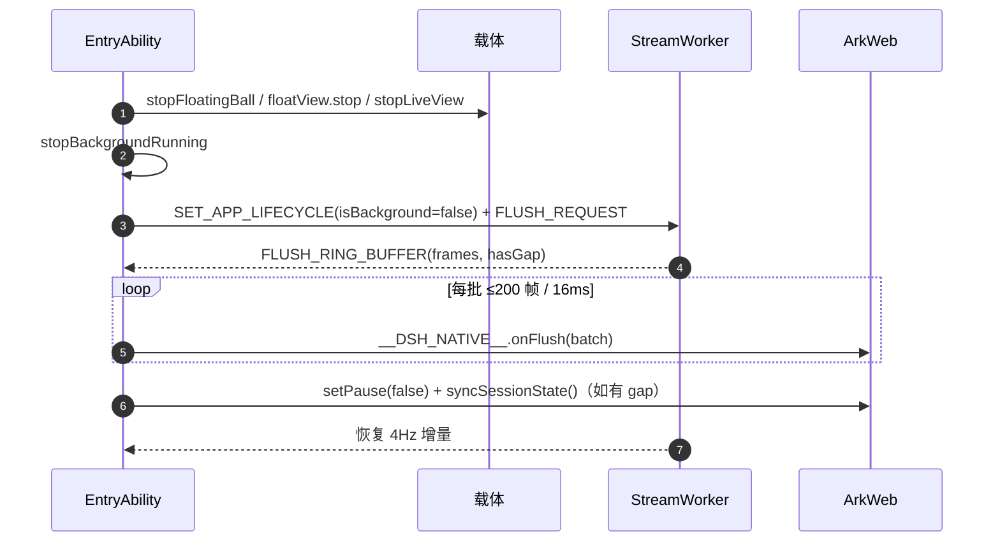
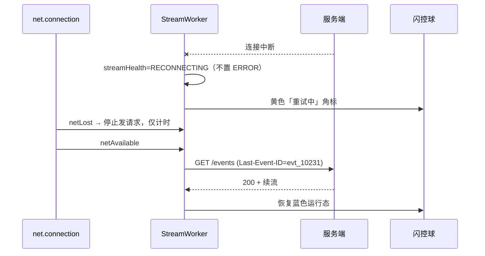
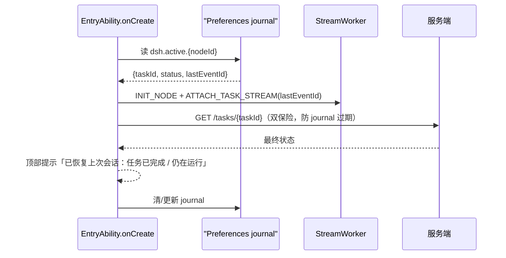

# DS-Harness-HM 技术方案设计

| 项目 | 内容 |
| --- | --- |
| 文档版本 | v1.0（方案基线版，可进入任务拆解与编码） |
| 上游文档 | [docs/prd.md](./prd.md) v2.0 |
| 目标平台 | HarmonyOS NEXT，`compatibleSdkVersion` = 6.0.0(API 20)，`targetSdkVersion` = 26.0.0 |
| 工程基线 | 单 HAP（`panel`）+ Stage 模型，ArkTS strict，`useNormalizedOHMUrl` |
| 适用范围 | 方案设计（架构 / 时序 / 契约 / 数据 / 风险 / 任务拆分）。不含业务代码实现 |
| 决策前提 | ①服务端走**双轨**（主动契约优先 + 嗅探兜底）；②窗口能力**不确定**，按能力分级降级；③**API 20 与 API 26 双版本兼容**；④本次只交付设计文档 |

---

## 0. 阅读指引与术语

- 本文档面向研发落地，所有接口、状态、错误码均可直接翻译为 ArkTS 代码；未标注 `[待确认]` 的内容视为设计已定，可直接编码。
- PRD 中的编号（`E-1.1`、`R-01`、`Mod-*`）在本文中保持引用一致。
- 术语：
  - **Worker**：`@ohos.worker.ThreadWorker` 承载的独立线程，持有全部网络连接与后台缓冲。
  - **主线程**：`UIAbility` + ArkUI 渲染线程 + `WindowManager` 调用方，唯一可以操作 UI / 悬浮窗 / 通知 / AppStorage 的执行体。
  - **ArkWeb 渲染进程**：不可控、后台会被冻结、**任何后台关键链路都不得依赖它**。
  - **L0~L3**：呈现层能力阶梯（详见 §3.4）。
  - **CONTRACT / SNIFF**：单节点的工作模式，前者依赖服务端原生契约，后者依赖注入脚本零侵入嗅探。

---

## 1. 结论摘要（TL;DR）

1. **否决 Native NAPI，选用 ArkTS Worker**。`@ohos.net.http.requestInStream` + `on('dataReceive')` 已能实现完整 SSE 流式读取，`@ohos.net.webSocket` 亦可携带自定义 Header，无需 NAPI 层，直接砍掉 C++ 编译链与跨语言调试成本。
2. **ArkWeb 降级为「纯前台渲染器」**。免登、握手、配置拉取、流式解析、审批下发、补偿同步全部由主线程 + Worker 完成；Web 只负责画。这是整套方案能在后台活下来的根因。
3. **单一事实源**：`ConnectionState` 唯一权威在 Worker；`TaskState` 由 Worker 从事件流派生后上报（主线程只读）；`PresentationState` 唯一权威在主线程。三者用 `revision` 单调号 + `nodeId` 命名空间收敛，禁止双向回写。
4. **契约按 DSH 真实实现落地（v1.1 修正）**：DSH 的认证是「一次性启动 token → 签名 Cookie」，传输是 `POST /api` + `WS /api/remote.mux` + `$events`，状态模型是 session/turn/step/approval。因此客户端主路径改为 **伴生插件契约 `/api/harness-native/*`**（推荐）+ **原生协议**（兜底）+ **SNIFF**（最后）。详见 §3.6。
5. **呈现层四级能力阶梯 + 运行时探测 + 自动降级**：L0 通知 / L1 悬浮球 / L2 球窗联动 / L3 实况窗。**已知通过调试证书 + ACL 可拿到窗口权限，故 L2 为主、L0 仍必须完整**（防权限被回收/换机/审核变化）。
6. **HITL 审批永不经过 ArkWeb**：闪控窗/通知按钮 → Worker → `POST /api/harness-native/confirm`（或 `$events/result`），端到端 P95 ≤ 800ms。
7. **节流分级**：常规遥测 2Hz；**状态跃迁类事件（审批、完成、错误）旁路节流**（≤200ms 一次）。PRD 的 2Hz 若一刀切，会把审批通知延迟到 500ms，违反场景 4 的「1 秒闭环」体验预算。
8. **RingBuffer 2MB 上限 + 三级优先级淘汰**：显式丢弃 `token` 增量、保留 `step/approval/error/done`，并向 Web 上报"存在空洞"，避免 PRD 所说的"丢最旧中间态"造成状态不连续。
9. **长时任务（Q11 已确认走 ACL 路线）**：手机普通签名只能 `MODE_DATA_TRANSFER` 且新式 API 要求 live-view 通知；既然有 ACL，就申请 `KEEP_BACKGROUND_RUNNING_SYSTEM` 走 **`MODE_TASK_KEEPING`**（普通通知即可，不依赖实况窗权益），`DATA_TRANSFER` 作次选。同时保留 15s 心跳 + 30s 通知进度刷新 + 撤销监听。
10. **交付拆分**：4 个客户端模块 + **1 个 DSH 伴生插件** + 1 个前置 Spike；全量约 **66 人日**、MVP（剔除可延后项）约 **56 人日**；2 人并行约 **7 周**。
11. **导入链路的稳定性风险已明确定位**：DSH 的启动 token 是**进程级**的，重启即变。因此方案引入「设备配对令牌」（插件 mint、存 `$DSH_HOME/.credentials.yaml`、跨重启有效），否则每次 DSH 重启都要重扫二维码。

---

## 2. 设计目标与范围

### 2.1 目标（In Scope）

- 场景 1：Token 化 URL / DeepLink / 粘贴 / 扫码导入，1 秒级完成配置拉取到"可用工作区"。
- 场景 2：接管 PC/云端存量运行中任务，`Last-Event-ID` 续流。
- 场景 3：有活跃任务时切后台零中断，2Hz 悬浮态展示；无任务时零打扰。
- 场景 4：离开应用完成 HITL 审批，1 秒闭环。
- 场景 5：零侵入嗅探兼容第三方/标准版 Harness。
- 场景 6：R-01 ~ R-04 全部自愈降级路径。
- 三维状态机与跨线程数据矩阵（PRD §1）的工程化落地。

### 2.2 非目标（Out of Scope，本期不做）

| 不做的事 | 原因 / 后续 |
| --- | --- |
| 服务端实现与 `/api/v1/*` 的实现代码 | 本方案只定义客户端消费的契约与兼容策略 |
| 工作区内的对话 UI、Markdown 渲染 | 复用 Harness Web 前端，客户端不自研 |
| 离线发起任务 / 离线写操作 | 需要服务端队列语义，本期只做只读回放与接管 |
| 多设备协同（手机↔平板无缝迁移） | 依赖分布式任务，风险高，V2 评估 |
| 应用市场合规文案与隐私声明最终稿 | 本文只给"必须准备的材料清单"（§10.8） |
| C++ NAPI 层 | 见 §3.5 决策 |

### 2.3 PRD 覆盖对照（评审用）

| PRD 条目 | 本文落点 | 说明 |
| --- | --- | --- |
| §1.1 三维状态机 | §5.1~§5.5 | 补 `AUTH_EXPIRED`、`streamHealth`、降级态与非法迁移 |
| §1.2 数据分布矩阵 | §6.1~§6.7 | 四层存储 + 跨线程同步 + 容量/淘汰策略 |
| 场景 1 / E-1.1~E-1.4 | §7.1、§9.1 | 两段式注入、nodeId、TOFU+CA、反向同步防自激 |
| 场景 2 | §7.1.3、§7.2.2、§9.1 | `activeTask` + `Last-Event-ID` 续流 |
| 场景 3 / §3.2 五态 / §3.3 | §5.4、§7.3.2~§7.3.7、§9.2、§9.4 | 五态载体 + 2Hz + 补偿 flush |
| 场景 4 | §7.2.7、§7.3.4、§9.3 | HITL 直连 + L0 通知兜底审批 |
| 场景 5 | §7.4.3、§7.4.4 | tee + Handover + lease + DOM 兜底 |
| 场景 6 / R-01~R-04 | §5.3、§7.3.7、§7.2.4、§7.3.8 | 降级链、退避重连、冷启恢复 |
| §3.1 线程协议 / §3.2 遥测结构 | §8.1、§8.2 | 完整类型定义（含扩展） |
| §4 NFR 1~3 | §10.1~§10.3 | 节流/审计/尺寸合规 |
| §5 四个 Sub-Spec | §4.3、§7、§12 | 目录落位 + WBS |

---

## 3. 平台能力核实（设计基线）

> 本节所有结论均来自本机 SDK：`C:\Program Files\Huawei\DevEco Studio\sdk\default`（`openharmony/ets` apiVersion **26**、`hms/ets` 26.0.0 Beta2）与 `toolchains/lib/PermissionDefinitions.json`。**这些结论直接决定架构分支，编码前务必在目标真机复验一次（Spike 任务 T0）。**

### 3.1 能力矩阵

| 能力 | SDK 声明 | 权限 / 等级 | 普通签名可用性 | 对方案的影响 |
| --- | --- | --- | --- | --- |
| `@ohos.window.floatingBall` | since **20**，`SystemCapability.Window.SessionManager` | `ohos.permission.USE_FLOAT_BALL`，`system_grant`，**`system_basic`**，`provisionEnable: true`，deviceTypes: phone/tablet/2in1 | ⚠️ 需 ACL 授权的 profile | L1，且只能显示 `title/content/icon` |
| `@ohos.window.floatView` | since **26.0.0** | `FLOAT_VIEW`（`user_grant`、`system_basic`）+ `USE_FLOAT_BALL` | ⚠️ 需 ACL + 运行时授权 + API26 | L2，内容是**自绘路由页** |
| `@hms.core.liveview.liveViewManager` | since 4.1.0(11) | 无显式权限，但 `startLiveView` 会返回 `1003500005 The right of liveView is not enabled` | ⚠️ 需开通实况窗权益 | L3（R-01 的降级目标） |
| `backgroundTaskManager`（DATA_TRANSFER） | since 7（旧 API）/ 21（`ContinuousTaskRequest`） | `ohos.permission.KEEP_BACKGROUND_RUNNING`，`availableLevel: normal` | ✅ 可用 | 保活基石；**但见下方强耦合约束** |
| `MODE_DATA_TRANSFER` 的进度通知 | 新 API 文档明确：**进度通知类型必须是 live view**，且 10 分钟内必须更新进度否则撤销 | — | ⚠️ 与实况窗权益强耦合 | 决定用旧 API 还是新 API（§7.3.3） |
| `MODE_TASK_KEEPING`（"计算类"保活） | since 21 | 仅 PC/2in1，或需 ACL `KEEP_BACKGROUND_RUNNING_SYSTEM`（`system_basic`） | ❌ 手机普通应用不可用 | 不能作为手机兜底 |
| `MODE_SPECIAL_SCENARIO_PROCESSING` | since 22 | 需 ACL `KEEP_BACKGROUND_RUNNING_SPECIAL_SCENARIO` | ❌ | 不采用 |
| `@ohos.security.asset` + `IS_PERSISTENT` | since 11 | `IS_PERSISTENT` 需 `ohos.permission.STORE_PERSISTENT_DATA`（`normal`） | ✅ 可用 | Token 存储 + 卸载保留 |
| `@ohos.pasteboard` 静默读 | — | `READ_PASTEBOARD`：`user_grant`、**`system_basic`** | ❌ 静默读不可用；前台读会触发系统提示 | 场景 1 触发入口 2 改为"前台 + 显式/被动粘贴"（§7.1.7） |
| 全局悬浮窗 `SYSTEM_FLOAT_WINDOW` | since 7 | `system_basic` | ❌ | 不采用（见 §3.4 L2.5 备选） |
| `@ohos.net.http` `requestInStream` + `dataReceive` | ✅ | `INTERNET` | ✅ | SSE 客户端可行，**无需 NAPI** |
| `@ohos.net.webSocket` | ✅ 支持 `header` | `INTERNET` | ✅ | WS 通道可行 |
| `Web` `javaScriptOnDocumentStart` / `webview.runJavaScriptOnDocumentStart` | ✅ | — | ✅ | 免登注入与嗅探注入的落点 |
| `WebCookieManager.configCookieSync` | ✅ | — | ✅ | Step 4.1 预置 Cookie 可行 |
| `http.HttpRequestOptions.caPath / remoteValidation: 'skip'` | ✅ | — | ✅ | 自签名/内网证书的正确解法（§7.1.8） |

### 3.2 关键结论：`floatView` 真实形态（修正 PRD 假设）

`FloatViewController` 的完整 API 面为：`setUIContext(path, storage?)`、`setUIContextByName(name, storage?)`、`setWindowSize()`、`switchTemplate()`、`start()`、`stop()`、`setFloatViewVisibilityInApp()`、`restoreMainWindow()`，以及 `onStateChange/onRectChange/onLimitsChange`。

由此得到两条必须写进设计的硬结论：

- **闪控窗内容 = 我们自己的 ArkUI 路由页**（路径须登记在 `main_pages.json`），状态通过 `LocalStorage` 通道注入，而非"系统模板统一绘制卡片"。因此 PRD 场景 3.2 的五态卡片 UI 可以 100% 还原。
- **`FloatViewTemplateType` 只有 `ROUNDED_RECTANGLE(0)` / `HORIZONTAL_BAR(1)` 两种外形模板**，尺寸受 `getFloatViewLimits(templateType)` 约束（`minSize/maxSize/ratioLimits`），折叠屏展开会触发 `onLimitsChange`，必须做自适应重排。

### 3.3 权限现实（最需要提前处理的风险）

`USE_FLOAT_BALL` 与 `FLOAT_VIEW` 的 `availableLevel` 都是 `system_basic`，普通应用 APL 为 `normal`，**只能在 `p7b` profile 的 ACL 中跨级申请**（`provisionEnable: true` 表示允许写入 ACL，但需向华为申请）。这意味着：

- Debug 签名的自动签名 profile **无法**授权这两个权限，`module.json5` 里声明了也只会拿到 `201 Permission verification failed`。
- 所以方案不能把"悬浮球 = 必有能力"作为前提，必须实现 §3.4 的阶梯 + §7.3 的探测与降级。
- 实况窗同理（需权益开通），`isLiveViewEnabled()` 返回 false 或 `startLiveView` 抛 `1003500005` 即视为不可用；且 `LiveView.event` 需落在 `PROGRESS/TAXI/...` 等系统场景内，按场景还要单独申请权益。
- **更隐蔽的一条**：新式 `ContinuousTaskRequest` + `MODE_DATA_TRANSFER` 明确要求"进度通知类型必须是 live view"。因此在没有实况窗权益的设备上，P0 走**旧式** `startBackgroundRunning(context, BackgroundMode.DATA_TRANSFER, wantAgent)`（API 9+，系统会展示普通文本进度通知），新式 API 仅在有实况窗权益时启用。这是 Spike(T0) 必须实测的第一项。

### 3.4 呈现层能力阶梯（Capability Ladder）

| 级别 | 载体 | 前置条件 | 能力 | 用户可见差异 |
| --- | --- | --- | --- | --- |
| **L3** | 实况窗 `liveViewManager`（状态栏胶囊 + 锁屏卡片 + 实况窗通知） | 权益开通 + `isLiveViewEnabled()` | 进度百分比、状态文案、点击回主界面、锁屏可见 | 最"系统原生"，但不能在胶囊里放审批按钮 |
| **L2** | 悬浮球 + 闪控窗（`floatingBall.bind(floatView)`） | API ≥ 26 + `USE_FLOAT_BALL` + `FLOAT_VIEW` + 用户授权 | PRD 场景 3.2 完整五态 + 快捷审批 | 与 PRD 完全一致 |
| **L1** | 仅悬浮球（`floatingBall`，`EMPHASIZED`/`STATIC` 模板） | API ≥ 20 + `USE_FLOAT_BALL` | 贴边球 + `Step 4/10 · 00:42` 文本 + 点击回应用；审批只能靠通知 | 无卡片、无按钮（球上不可自绘控件） |
| **L0** | 常驻进度通知（`notificationManager`）+ ActionButton + 长时任务 | 仅 `KEEP_BACKGROUND_RUNNING`（`normal`） | 进度条、状态文案、`批准/拒绝/打开` 三个 Action 按钮（走透明审批页） | **默认兜底，必须做到体验可用** |
| L2.5（备选，不建议） | 全局悬浮窗 `window.create` + `SYSTEM_FLOAT_WINDOW` | `system_basic` | 自由自绘 | 审核风险高、无系统动效，仅当 L2 不可得且 L0 无法满足审批 SLA 时评估 |

> **设计原则**：L0 必须是"完整可用"的降级路径，而不是残缺版。L0 的审批通过 **通知 ActionButton → 拉起一个透明背景的 `HITLApprovalAbility`（半模态，不切走原应用视觉上下文太久）→ 回退** 实现，等效完成"不打开主界面也能审批"。

### 3.5 架构决策记录（ADR）

| ID | 决策 | 备选 | 理由 | 代价 |
| --- | --- | --- | --- | --- |
| ADR-01 | 通信工作线程用 **ArkTS Worker** | Native NAPI；主线程直连 | `http.requestInStream` 满足 SSE；少一层跨语言；Worker 崩溃可重建，主线程不受影响 | Worker 内存与主线程隔离，需序列化大 chunk（用 `ArrayBuffer` transfer 缓解） |
| ADR-02 | ArkWeb **只做前台渲染**，后台路径一律绕开 | 后台保活 Web | 系统冻结渲染线程是平台行为，不可对抗 | `SNIFF` 模式下必须实现 Handover，复杂度上升 |
| ADR-03 | 双轨模式 **CONTRACT 优先、SNIFF 兜底**，按节点记忆 | 只做 CONTRACT | 兼容第三方标准版 Harness | 两套解析器 + 一致性保障成本 |
| ADR-04 | 呈现层 **L0 兜底 + 阶梯升级** | 强依赖悬浮球 | 权限现实（§3.3） | 三种载体都要做，UI 复用度需设计 |
| ADR-05 | 关键状态事件 **旁路 2Hz 节流** | 严格 2Hz | 审批 SLA 优先于功耗极值，且关键事件频率极低 | 需白名单机制，防止被滥用成高频通道 |
| ADR-06 | 免登注入用 **两段式**（Token 先、配置后） | PRD 的严格串行 4 步 | 满足 1 秒导入预算（§7.1.6） | 需保证配置快照晚到时不闪变（占位骨架 + 幂等注入） |
| ADR-07 | 证书信任用 **TOFU + caPath** | 关闭 SSL 校验 | `http` 无 per-host 关闭开关；`caPath` 是正解 | 需引导用户导出内网 CA |
| ADR-08 | RingBuffer 用 **优先级淘汰 + 空洞标记** | 简单 FIFO 丢弃 | 保住状态连续性 | 前端需处理 `gap` |
| ADR-09 | 客户端主路径改为 **伴生插件（Host 侧）+ 原生协议双轨**，而非纯注入 | 纯嗅探；直接实现整套 Typert RPC | 自部署可改宿主；插件能用公开 seam 提供稳定契约（§3.6） | 需维护一个 DSH 插件，跟随 DSH 版本 |
| ADR-10 | 认证按 **DSH 真实模型**（一次性启动 token → 签名 Cookie）而非自造 Bearer | PRD 的 `Authorization: Bearer {token}` | DSH 只接受 query token 换 Cookie，且 WS 与 HTTP 共用该 Cookie | 需要 Cookie 罐与 `/connect` API Peer |

---

### 3.6 DSH 宿主侧真实契约核查（v1.1 新增，Q1/Q2 的答案）

> 依据：本机 DSH 0.2.2-rc.1 安装包内 `@deepseek-ai/dsh-*` 各包的 `README.zh.md`（`dsh-web-app`、`dsh-client-connection`、`dsh-api-gateway`、`dsh-api-remote-access`、`dsh-host-webserver`、`dsh-api-session-controller`、`dsh-user-approval`）。**这些是宿主实现的权威说明，比 PRD 的假设更可靠。**

#### 3.6.1 部署与监听（Termux + proot 场景直接适用）

```sh
dsh --profile web \
    --no-open \
    --host <容器内具体 IP 或 127.0.0.1> \
    --port 3080 \
    --public-url https://<你的公网域名>/ \
    --trusted-host <你的公网域名>
```

- `--host` **只接受一个具体 IPv4/IPv6 字面量**，通配地址（`0.0.0.0`、IPv4-mapped any）会在启动时被拒绝。→ proot 内一般绑定 `127.0.0.1`，让穿透客户端（frp/cloudflared 等）在**同一 netns** 内转发；若穿透客户端在 proot 之外，则绑定容器的实际地址。
- `--public-url` 只负责"**公告**"对外根（打印的 URL、`DSH_WEB_URL`、agent 上下文），**不授予任何信任**；浏览器可见的 authority 必须再用 `--trusted-host` 点名。
- 未启用 `--tls-cert/--tls-key` 的非 loopback 监听是**明文 HTTP**；反向代理终止 TLS 时，DSH 监听器签发的 Cookie **不会带 `Secure`**（这是文档明示的限制）。→ 手机端必须走 `https`，且要知道"隧道内这段是明文"。

#### 3.6.2 认证模型（与 PRD 假设差异最大）

| 场景 | 真实机制 |
| --- | --- |
| 浏览器/WebView | 每个进程生成**一次性启动 token**；`GET /?token=...` 校验通过后写入**签名 Cookie**（`HttpOnly`、`SameSite=Strict`、`Path=/`、30 天、绑定 `hostname+port` 与 scheme），302 到干净的 `./`（移除 token）。之后所有 RPC 与 WS 升级都靠该 Cookie。 |
| 纯 API 客户端 | `GET /connect?token=...&interactions=answer\|none` → 302 + **mux 目标地址** + **签名 API Cookie**；`interactions` 默认 `none`，非法/重复声明返回 400。 |
| 信任栅栏 | 每个请求先校验 `Host`：必须是 loopback、监听器绑定 IP，或命中 `--trusted-host`；若带 `Origin` 必须同 authority；`sec-fetch-site: cross-site` 一律拒绝。失败 **403**；Host 可信但未认证 **401**。 |
| API Peer 生命周期 | 一个 API Peer 由**一条 WS socket** 持有："重复关联返回 409"，socket 关闭即移除 Peer，之后的 HTTP 也被拒。 |

**对方案的三条硬影响**：

1. **PRD 的 `Authorization: Bearer {token}` 不存在**。原生 Worker 必须实现 Cookie 罐：`GET /connect` → 解析 `Set-Cookie` → 之后每个请求带 `Cookie`，WS 握手也带。ArkTS `http.HttpResponse.cookies` 可取到，需自行保存/回送。
2. **启动 token 是进程级的，DSH 重启即失效**。保存"导入链接"在重启后必然 401（除非仍在 30 天 Cookie 有效期内、且签名密钥记录未删）。→ 需要 Q1 的长期凭据方案（§3.6.5 的伴生插件 mint 设备令牌，或接受"每次重启重新导入"）。
3. **免登不再需要"往 localStorage 注入 token"**：WebView 只需加载一次 `https://host/?token=...`，Cookie 落进 WebView 的 CookieStore，页面后续导航天然免登。原 PRD 的 E-1.1（防路由守卫闪现登录页）由"先完成 Cookie 交换再挂载 WebView"来满足，比注入脚本更稳。

#### 3.6.3 传输与协议栈

```
HTTP  POST /api            ← 一元 RPC（JSON 信封；带字节附件时改 multipart）
WS    /api/remote.mux      ← 多路复用逻辑流：open / ready / item / end / cancel
                             · Host 每 2s 发 Ping 控制帧（可由 websocketHeartbeatIntervalMs 配）
                             · permessage-deflate（>1024 字符的 JSON 帧才压缩）
                             · 上行 inbox 上限 streamInboxBytes 默认 256KB
                             · 连续两个 Ping 周期无活动则 Host 断链
事件  $events（逻辑流）     ← 唯一 ready 帧 { clientId, host: { home } }，随后事件帧
      $events/result        ← 对 waterfall（审批）作答，经 HTTP 一元载体回送
```

- 重连策略在 **Client 侧**（Connection）：500ms → 1s → 2s → 4s → 8s → **10s 封顶**，50%~100% 抖动；每次重试都要换一条物理 WS，再重开 `$events`；握手 3s 告警、15s 就绪超时。→ 与本方案 §5.2 的退避参数应**对齐该曲线**（原设计的 30s 封顶偏大，改为 10s 封顶更贴合宿主行为）。
- `$events` 参与（回答审批）要求 `interactions: 'answer'`，且**只有 owner Peer 能回答 waterfall**。API Peer 的 principal 就是 owner，满足条件。

#### 3.6.4 状态模型（PRD 的"task/step"在 DSH 里叫什么）

| 客户端概念（PRD/本方案） | DSH 真实概念 | 取值来源 |
| --- | --- | --- |
| 节点 Node | Host（一个 `dsh` 进程）+ Workspace | `session/list`、`workspace/*` |
| 任务 Task | **Session**（一次会话） | `session/list`、`session/control` |
| 单次执行 Run | **Turn**（`turn/start`…）| `session/follow` 事件流 |
| 步骤 Step | **Step**（`step/start`/`step/end`）+ 工具调用行 | `session/follow` |
| `stepCurrent/stepTotal` | 没有天然总数；用 **todo 列表完成度** 或"已完成 step 数 / 计划条目数"合成 | `session/control` 的 projection（todo/plan） |
| 等待审批 `WAITING_APPROVAL` | **`approval/request` waterfall 未结算** | `$events` 帧 + `dsh-user-approval` |
| 中断任务 | `session/control` 的取消/停止动作 | `session/control` |
| 消息历史 | `session/follow` 的 journal（`turn/*`、`assistant/message`、`step/*`） | journal 流（含分页与补洞） |

> 这一对照决定了 §8.2 的 `TaskTelemetrySnapshot` 只能是**客户端聚合视图**，字段由上述来源派生，而不是服务端直接下发。

#### 3.6.5 可用的宿主扩展点（`Q2：开发插件就行吗？`——行，而且这是最优路径）

| 扩展点 | 来源包 | 能做什么 |
| --- | --- | --- |
| `webserver/index-inject` 事件 + `tapIndex` | `dsh-host-webserver` | 往 index.html 注入 `<script>`/全局变量（每次渲染按 Peer 计算）→ **`window.HarmonyHarnessBridge` 的落点**，无需 monkey-patch |
| `register()` / `registerUpgrade()` 具名路由 | `dsh-host-webserver` | 注册自己的 HTTP 路由与 WS upgrade；**但这条路不带认证**（路由 owner 自负请求策略） |
| Connection 精确 Fetch 路由注册表 | `dsh-client-connection` | 更推荐：挂在 `/api` 桥接的精确路由上，**自动继承 token/Cookie 认证与 Host/Origin 栅栏**，并拿到 Peer |
| `ctx.typertGateway` / `@Remote` | `dsh-api-gateway` | 注册真正的 Remote 端点（会被 Client 的类型系统消费） |
| `registerRemoteEvents()` | `dsh-api-gateway` | 向所有 Client 广播 Host 事件（走 `$events`） |
| `approval/request` waterfall 监听 | `dsh-user-approval` | **注册审批应答者**（`ask` 策略下唯一能结算审批的机制） |
| `session/*` 服务 | `dsh-api-session-controller` | 读 `session/control` 快照、订 `session/follow`（进度与工具行的数据源） |

> ⚠️ **安全红线**：直接 `register()` 到 `ctx.webServer` 的路由**不经过** `connection.authorize`。在公网域名上，任何这样的路由都等于对外开放的裸端点。伴生插件必须二选一：①挂在 Connection 的精确路由表（推荐）；或 ②自己实现 token 校验 + Host/Origin 栅栏 + 速率限制。

#### 3.6.6 三种集成路径与选型

| 路径 | 做法 | 前台 | 后台 | 客户端成本 | 宿主改动 | 结论 |
| --- | --- | --- | --- | --- | --- | --- |
| **B（推荐）伴生插件** | 写一个 Host 插件：`/api/harness-native/*`（bootstrap / SSE / confirm）+ index 注入 bridge + 长期设备令牌 | 走 WebView + bridge（也可直连） | Worker 直连 SSE | 低（HTTP+SSE+Cookie） | 1 个插件包 | ✅ 主路径 |
| **A 原生协议** | 直接实现 `/connect` + `POST /api` 的 Typert 信封 + `/api/remote.mux` 逻辑流 + `$events` waterfall | ✔ | ✔ | **高**（帧协议 + 端点描述符 + deflate + 心跳） | 无 | 作为兜底/未来（若不想写插件） |
| **C 纯注入** | 原 PRD 的 monkey-patch | ✔ | ✘（Web 冻结） | 中 | 无 | 仅作 B 缺失时的降级 |

**B 的接口设计**（插件实现，客户端只需这三条 + 一条 WS）：

```
GET  /api/harness-native/bootstrap        → { schemaVersion, host, workspaces[], sessions[], activeSession?,
                                              capabilities:{confirm,abort,stream:'sse',pairing:true} }
GET  /api/harness-native/events?sessionId=→ text/event-stream（step/tool/approval/message 摘要）
POST /api/harness-native/confirm          → { sessionId, approvalId, decision, rememberRule? }
WS   /api/harness-native/live             → 可选：双向 control（abort / steer），带 ping
```

- 三条路由挂在 Connection 精确路由表上 → 自动获得 Cookie 认证与 Host/Origin 栅栏。
- SSE 事件体建议**沿用 DSH 语义名**（`turn/start`、`step/start`、`tool/call`、`approval/request`、`approval/resolved`、`turn/end`），客户端只做薄映射，避免自造第二套词汇。
- 若不做插件（路径 A/C），客户端的 §8.3 契约表作废，改用 §3.6.3 的真实协议。

#### 3.6.7 真机联调实测结论（v1.2，域名 `dsh.example.com`）

已用真实 token 打通并逐条验证（可复现命令见附录 D）：

| 项 | 实测结果 | 设计含义 |
| --- | --- | --- |
| `GET /?token=` | **303** + `Set-Cookie: dsh-auth-<hash>=v1.<payload>.<sig>`（Max-Age 30d、HttpOnly、SameSite=Strict、`Path=/`），`location: ./` | 与 §3.6.2 一致；注意是 **303** 不是 302，客户端要跟随 303 |
| Cookie payload | `{"version":1,"authority":"127.0.0.1:3080","issuedAt":…,"expiresAt":…}` | **authority 是监听器地址**！说明 nginx 把 `Host` 改写成了 `127.0.0.1:3080`（否则 auth 不会通过）。→ 反代必须保留/改写为该 authority，且客户端不要用 DSH 公告的 origin 去拼绝对地址 |
| `GET /connect?...&interactions=answer` | **302** + `location: ./api/remote.mux` + API Cookie（`v2.…`，多一个 `id`） | mux 地址是**相对路径**，客户端必须按当前 origin 解析，不能当绝对 URL |
| `POST /api` | **404 `not found`**（纯文本） | 端点**在路径里**，不是 body 里 |
| `POST /api/session/list` + 猜测 body | 200 + `gateway/internal: Remote payload must contain exactly one plain-object args field` | 信封对了一半，payload 形状错 |
| `POST /api/session/list` + `payload:{args:{}}` | 200 + `gateway/arguments-invalid: missing "_request"` | 参数必须是 `payload.args = { <参数名>: {...} }`，`session/list` 的参数名叫 `_request` |
| `POST /api/session/list` + `payload:{args:{_request:{}}}` | **200 + 约 99KB 真实数据** | 契约打通，数据模型确认 |

**正确的 RPC 调用格式（写进客户端与插件）**：

```http
POST /api/<endpoint>            ← endpoint 在路径中（如 /api/session/list）
Content-Type: application/json  ← 必须精确，否则 415
Cookie: dsh-auth-<hash>=v1|v2.…
Origin: https://<对外域名>       ← 必须与 Host 同 authority

{"type":"client-request","rpcId":"r1","method":"session/list","payload":{"args":{"_request":{}}}}
```

失败语义（实测）：`401` 无/坏 Cookie；`415` content-type 不对；`400` body 不是 JSON；`404` 端点路径不被认领（含 method 与路径不一致）；`400/200+gateway/arguments-invalid` 参数不匹配描述符。

**真实数据模型（`session/list` 的 projection，非常重要）**：

```json
{ "sessionId":"session-db5e…", "updatedAt":1794050212869, "agentAvailable":true,
  "running":false, "blank":false, "cwd":"/root/dsh",
  "projections": { "kind":"sequenced", "asOfSeq":3472, "values": {
    "title":"鸿蒙HAP广告审计与skill封装",
    "goal":null,
    "tokenUsage":{ "uncachedInputTokens":386172,"outputTokens":283003,"cacheReadTokens":150152185 },
    "contextPressure":{ "pressureTokens":610415,"projectedTokens":610884,"contextWindow":1000000 },
    "sessionStats":{ "turns":14,"steps":431,"llmMs":9047217,"toolMs":3225741,
                     "ttftMs":3414515,"ttftSteps":430,"decodeMs":5632702,"decodeTokens":283003 },
    "turnOutline":[ { "turn":1,"seq":4,"prompt":"…","response":"…" } ],
    "inbox":{ "next-turn":[], "next-step":[] } } } }
```

由此修正 PRD 的进度模型（**这版是实测口径**）：

| PRD 字段 | 真实可用来源 | 建议口径 |
| --- | --- | --- |
| `status` | `running`（bool）+ `agentAvailable` + `inbox` | `running=true` → RUNNING；`approval` 事件存在 → WAITING_APPROVAL |
| `stepCurrent/stepTotal` | `sessionStats.steps`（会话累计）/ `turnOutline.length`（轮次数） | **不要伪造"总步数"**：球上显示 `Turn 14 · Step 431`，或不带分母显示 `Step 431`；分子分母都真实 |
| `elapsedSeconds` | `updatedAt` / `turnOutline.last.seq` | 用 turn 起始时间 + 单调时钟 |
| `tokenSpeed` | `sessionStats.decodeTokens / decodeMs` | 直接可算，无需自行统计流 |
| `tokenUsage` | `tokenUsage` 四项 | 完成摘要直接取 |
| 上下文压力 | `contextPressure` | 可做"上下文将满"提示（PRD 没有，但很有价值） |
| `currentAction` / 日志 | 需 `session/follow` journal（`tool/*`、`step/*`） | 用 journal 流，不要再 DOM 嗅探 |

#### 3.6.8 伴生插件设计（Q13：设备配对 + 按手机吊销）

**为什么需要配对**：启动 token 是进程级的（§3.6.2），手机存它必然随 DSH 重启失效。配对把"一次性 token"换成"长期设备令牌"，并支持逐台吊销。

**令牌设计**：

```
deviceToken = base64url(32B CSPRNG)
存储：$DSH_HOME/panel-bridge/devices.json（0600）
结构：{ "version":1,
        "devices":[ { "id":"dev_…", "name":"Xiaomi 15", "tokenHash":"sha256(token)",
                      "createdAt":…, "lastSeenAt":…, "revokedAt":null,
                      "ua":"harmony/…", "scopes":["read","approve","abort"] } ] }
```

- 只存 `sha256(token)`，**不存明文**（与 DSH 自己的 credential 处理一致）；比较用常量时间。
- 吊销 = 写 `revokedAt`；鉴权时先查 `null` 再查未过期。`DELETE /api/panel/devices/{id}` 或 `POST /api/panel/devices/{id}/revoke`。
- 配对入口只接受**已通过 Cookie 认证的 owner**（浏览器/WebView 里已登录），所以 `POST /api/panel/pair` 挂在 **Connection 精确路由**上，天然受 Host/Origin 栅栏保护，不需要额外口令；`startupToken` 只在"无 Cookie 的首次引导"时作为可选二次证明。
- 设备令牌只用于**后台通道**（SSE/confirm）；前台 WebView 继续用 Cookie。两者互不复用，泄露面最小。

**插件模块与文件布局**（纯 ESM，无需构建，DSH 能直接 `import`）：

```
dsh-panel-bridge/
├── package.json            # name/version/type:module/main + peerDependencies cordis
├── lib/
│   ├── index.js            # 插件入口：注册路由 / 审批应答者 / index 注入
│   ├── devices.js          # 设备存储：pair / verify / list / revoke（原子写）
│   ├── events.js           # 内部事件总线 + SSE 编码（含 Last-Event-ID）
│   ├── approvals.js        # approval/request waterfall 应答者 + 待决队列
│   ├── auth.js             # 设备令牌校验 + 常量时间比较 + 速率限制
│   └── inject.js           # webserver/index-inject 注入的 bridge 脚本（字符串）
└── README.md               # Termux 安装/开发循环/吊销操作
```

**路由清单（全部走 Connection 精确路由，owner-only）**：

| 方法 | 路径 | 说明 | 认证 |
| --- | --- | --- | --- |
| GET | `/api/panel/bootstrap` | host/sessions 摘要（服务端聚合 `session/list` 的 projection） | Cookie（owner）或设备令牌 |
| GET | `/api/panel/events` | SSE：`turn/*`、`step/*`、`tool/*`、`approval/*`，支持 `Last-Event-ID` | 同上 |
| POST | `/api/panel/confirm` | `{sessionId, approvalId, decision, rememberRule?}` | 同上 |
| POST | `/api/panel/abort` | `{sessionId}` | 同上 |
| POST | `/api/panel/pair` | 生成设备令牌（返回一次明文） | **仅 Cookie** |
| GET | `/api/panel/devices` | 设备列表（脱敏） | 仅 Cookie |
| POST | `/api/panel/devices/{id}/revoke` | 吊销 | 仅 Cookie |

> 若确认 `Response` 支持流式 body（undici ReadableStream），`/events` 可直接 SSE；否则退化为 `GET /api/panel/events/long-poll?sinceSeq=`（3s 挂起）——**这是插件落地时第一个要实测的点**（联调项 J1）。

**审批应答者**（`approval/request` waterfall）是审批的唯一真源：

```
approval/request 到达
  ├─ 若本请求来自"面板"通道（移动端在线）→ 入 pending 队列，广播 approval/request 事件
  ├─ 移动端 POST /confirm → 结算该 waterfall（返回 { decision, rememberRule }）
  ├─ 超时（默认 120s，与宿主 timeout 对齐）→ 结算为 reject/cancel 并记审计
  └─ 若移动端不在线 → 调 next() 让浏览器 UI 处理（不抢占）
```

**WebView 注入**（`webserver/index-inject`）只做两件事，避免把逻辑塞进页面：

```js
// 注入内容（极简）：告诉页面"原生侧在"，并暴露只读快照钩子
window.__DSH_PANEL__ = { version: 1, bridge: 'native', onNativeState(fn) { … } };
```

**安装与开发循环（Termux + proot）**：

```sh
# 1) 把插件目录放到宿主可读位置
cp -r dsh-panel-bridge ~/dsh-panel-bridge
# 2) 用官方安装入口（支持绝对路径 → link:）
#    GUI：侧边栏「插件」→ 安装 → 输入 /root/dsh-panel-bridge
#    或 agent 里：plugin_manager install_bundle target=/root/dsh-panel-bridge
# 3) 开发循环（有 HMR 时改完即生效；无 HMR 需重启 dsh）
dsh --profile web --no-open --host 127.0.0.1 --port 3080 \
    --public-url https://dsh.example.com/ \
    --trusted-host dsh.example.com
```

**安全红线（插件必须自己守住，因为 upgrade/自定义路由绕过了 Connection 的认证）**：

1. 设备令牌通道**只允许** `GET /events`、`POST /confirm|abort`，绝不允许文件/终端类端点。
2. 所有响应带 `Cache-Control: no-store`；SSE 不压缩；令牌不出现在 URL（用 `Authorization: Bearer` 或 `X-Panel-Device`）。
3. 校验 `Host`/`Origin`（与 Connection 同规则），失败直接 403。
4. 每设备限速（如 10 req/s）+ 失败 5 次锁 60s，防公网爆破。
5. 审计：`pair`/`revoke`/`confirm` 各写一条 `hilog` 级日志到宿主日志，不含令牌明文。

#### 3.6.9 联调项清单（J1/J2/J4 已在目标机闭环）

> 插件骨架已在本仓：`dsh-panel-bridge/`（纯 ESM、无构建、`node --check` 通过）；探针脚本：`tools/panel-probe.ps1`。

| 编号 | 待定内容 | 判定方法 | 影响 |
| --- | --- | --- | --- |
| **J1**（✅ 已闭环） | 流式响应可用 | 实测 `/events` 返回 `retry: 1000` + 15s 心跳 | `/events` 用 SSE，无需长轮询 |
| **J2**（✅ 已闭环） | 会话数据源 | 实测 `ctx.get('sessionController').list({})`；`bootstrap` 返回 17 条真实会话（含 title/steps/running） | 服务名为 `sessionController`（RPC 命名空间 `session`） |
| **J3**（✅ 已闭环，走仿真通道） | 审批闭环 | 应答者已注册；实测该部署的原生 bash 不发起审批（切 `workspace-write`+`ask` 仍直接执行）。改用 loopback-only `POST /api/panel/_simulate-approval` 验证手机端链路：手机点「允许执行」→ `POST /api/panel/confirm` → 队列结算 → 广播 `approval/resolved`。审计日志实证：`approval/request(ap_1_mw73zmlm, rm -rf /opt/data, CRITICAL)` → `approval/resolved(APPROVE, by=user)` → `approval/confirm(settled=true, deviceId=dev_7a89…)` | 已闭环；真实审批要等宿主走沙箱 ask 路径 |
| **J4**（✅ 已闭环） | 停 turn | 实测 `sessionController.cancel({sessionId})`，不存在时原样返回宿主错误 | `/abort` |
| **J5**（⏳ 未开工） | `webserver/index-inject` 行形状 | 该版本事件只回调注入表（无 peer），行为 `{kind, name, value}` | WebView bridge 注入 |

**接续顺序**：J3（真实审批）→ J5（注入）→ 客户端 HAP 联调。

**新增实测结论（写代码前必读）**：

- 服务名：`sessionController`、`approval`；`SessionController.list(_request, signal)`。
- 精确路由 API：0.2.1 为 `connection.fetch.register(route)`，0.2.2 改为 `registerFetchRoute(owner, route)`（插件已双兼容）。
- **模块代码不热加载**：`patchReload: live` 只重放 patch 行，不刷新 ESM 模块缓存；更新插件必须换新的模块目录（`plugins/panel-bridge-N/`）并重启，或等宿主支持模块级 HMR。
- 重启 dsh 会连带断掉同机 sshd —— 用 detached 脚本（`nohup` 起 sshd + dsh）可自愈，避免锁死在外。

---

## 4. 总体架构

### 4.1 分层与执行体

```
┌───────────────────────────────────────────────────────────────────────────────┐
│ 呈现层 Presentation（主线程，ArkUI）                                           │
│  ┌──────────────┬───────────────┬──────────────┬──────────────┬────────────┐  │
│  │ MainPage     │ FloatCardPage │ HITLApproval │ Progress     │ LiveView   │  │
│  │ (ArkWeb 容器)│ (闪控窗路由页) │ Ability(透明) │ Notification │ Card       │  │
│  └──────┬───────┴───────┬───────┴──────┬───────┴──────┬───────┴─────┬──────┘  │
│         │               │              │              │             │         │
│  ┌──────▼───────────────▼──────────────▼──────────────▼─────────────▼──────┐  │
│  │ PresentationRouter（能力探测 → 选载体 → 降级链 + 用户提示）              │  │
│  └──────────────────────────────────┬───────────────────────────────────────┘  │
├─────────────────────────────────────┼───────────────────────────────────────┤
│ 领域层 Domain（主线程，纯逻辑）      │                                       │
│  ┌────────────┬──────────────┬──────▼────────┬──────────────┬────────────┐   │
│  │ NodeStore  │ UriSync      │ TelemetryHub   │ ApprovalGate │ RecoveryMgr│   │
│  │ (Preferences) │ (ASSET)   │ (AppStorage)   │ (幂等/防误触)│ (冷启自检) │   │
│  └────────────┴──────────────┴───────┬────────┴──────────────┴────────────┘   │
│  ┌───────────────────────────────────▼──────────────────────────────────────┐  │
│  │ WebBridge（JSBridge / 注入 / Tee / Handover / Flush）                    │  │
│  └───────────────────────────────────┬──────────────────────────────────────┘  │
├──────────────────────────────────────┼──────────────────────────────────────┤
│ 传输层（Worker 线程，独立 ArkTS 线程）│                                      │
│  ┌──────────────┬───────────────┬────▼───────┬──────────────┬─────────────┐   │
│  │ StreamClient │ ConnPool      │ RingBuffer │ EventParser  │ JournalStore│   │
│  │ (SSE/WS)     │ (多节点/退避) │ (2MB/分级) │ (双轨解析)   │ (SQLite)    │   │
│  └──────────────┴───────────────┴────────────┴──────────────┴─────────────┘   │
├───────────────────────────────────────────────────────────────────────────────┤
│ 系统能力：asset / preferences / relationalStore / http / webSocket /          │
│          connection / backgroundTaskManager / notification / vibrator /        │
│          floatingBall / floatView / liveViewManager                           │
├───────────────────────────────────────────────────────────────────────────────┤
│ ArkWeb 渲染进程（不可控，仅前台）：Harness Web App + 注入脚本                  │
└───────────────────────────────────────────────────────────────────────────────┘
```

### 4.2 线程职责与禁止事项

| 执行体 | 拥有 | 允许做 | **禁止做** |
| --- | --- | --- | --- |
| 主线程 | UI / 窗口 / 通知 / AppStorage / ASSET / Preferences | 状态聚合、载体渲染、JSBridge 宿主、审批 UI | 解析高频 SSE、长连接持有、阻塞 I/O |
| StreamWorker | 网络连接、流解析、RingBuffer、SQLite 写入、审批 HTTP | SSE/WS 维持、节流、派生遥测、直发 confirm/abort | 操作 UI / 窗口 / 通知 / AppStorage / Web |
| ArkWeb | 页面渲染 | 前台渲染、注入脚本内的 tee 与 DOM 观察 | 后台任何关键链路 |

> Worker 与 AppStorage 的关系：Worker **不能**直接写 `AppStorage`（跨线程）。所有遥测通过 `postMessage` 回主线程，由 `TelemetryHub` 写入 `AppStorage`。

### 4.3 代码落位（对齐 PRD 的 4 个 Mod）

```
panel/src/main/ets/
├── dshpanelability/DSHPanelAbility.ets        # 生命周期编排入口
├── hitl/HITLApprovalAbility.ets               # L0 降级审批页（透明 UIAbility）
├── pages/
│   ├── Index.ets                              # 主界面（ArkWeb 容器 + 顶部接管条）
│   └── FloatCard.ets                          # 闪控窗路由页（须登记 main_pages.json）
├── model/                                     # 纯类型与常量（无副作用）
│   ├── WorkerProtocol.ets                     # §8.1
│   ├── Telemetry.ets                          # §8.2 TaskTelemetrySnapshot
│   ├── EventFrame.ets                         # 事件帧与优先级
│   ├── NodeProfile.ets                        # 节点元数据 / 桥接模式 / 能力快照
│   └── ErrorCodes.ets                         # §8.6
├── uri/                                       # Mod-UriSync
│   ├── DshUriParser.ets
│   ├── UriNormalizer.ets
│   ├── NodeIdentity.ets                       # nodeId 生成
│   └── BootstrapClient.ets                    # 探针与配置拉取
├── storage/
│   ├── AssetVault.ets                         # ASSET 封装
│   ├── NodePreferences.ets                    # 多节点偏好 + 迁移
│   └── JournalPrefs.ets                       # 活跃任务轻量日志（R-04）
├── worker/                                    # Mod-StreamWorker
│   ├── StreamWorker.ets                       # Worker 入口
│   ├── SseClient.ets / WsClient.ets
│   ├── SseFrameParser.ets
│   ├── ConnectionPool.ets
│   ├── RingBuffer.ets
│   ├── EventDeriver.ets                       # 事件 → 遥测快照
│   ├── ApprovalRuleEngine.ets
│   └── JournalStore.ets                       # SQLite
├── presenter/                                 # Mod-FloatKeepAlive
│   ├── LifecycleOrchestrator.ets
│   ├── CapabilityProbe.ets
│   ├── PresentationRouter.ets
│   ├── ContinuousTaskController.ets
│   ├── NotificationPresenter.ets
│   ├── FloatingBallPresenter.ets
│   ├── FloatViewPresenter.ets
│   ├── LiveViewPresenter.ets
│   └── Haptics.ets
├── web/                                       # Mod-WebBridge
│   ├── WebBridgeHost.ets                      # JSBridge 注册与方法分派
│   ├── ScriptProvider.ets                     # 注入脚本装配（含 token）
│   ├── SecureUrlPolicy.ets                    # origin/header 白名单
│   └── assets/inject/*.js                     # 随包资源（见 §7.4.3）
├── domain/
│   ├── TelemetryHub.ets
│   ├── ApprovalGate.ets
│   ├── RecoveryMgr.ets
│   └── NodeRegistry.ets
└── ui/                                        # 组件与主题
    ├── TakeoverBanner.ets
    ├── ImportSheet.ets                        # 半模态导入确认
    ├── NodeListPage.ets
    └── theme/*
```

> `pages/FloatCard` 必须加入 `resources/base/profile/main_pages.json`；`HITLApprovalAbility` 必须加入 `module.json5` 的 `abilities` 并配置透明主题（`background` 为半透明、`exported: false`、`launchType: singleton`）。

---

## 5. 状态机设计

### 5.1 设计原则

1. **每个状态机只有一个写入者**（§1 第 3 条），其他模块只能发"意图事件"。
2. **状态跃迁必须由事件触发**，禁止直接赋值；所有跃迁走 `TransitionGuard`（合法性表 + 副作用回调）。
3. **可观测**：每次跃迁写一条 `hilog`（脱敏）+ 一个领域事件（`DomainEventBus`），便于复盘。
4. **可重建**：主线程重启后能仅凭 Worker 上报的 `TaskTelemetrySnapshot` + Preferences 恢复全部 UI 状态。

### 5.2 ConnectionState（Worker 权威）

```
                 ┌──────────────── DISCONNECTED ◄──────────────┐
                 │  IMPORT / ACTIVATE_NODE                      │ DISCONNECT_NODE
                 ▼                                              │
            HANDSHAKING ──(bootstrap 2xx)──► CONNECTED ─────────┘
                 │                            │  ▲
       (超时/网络错)│                    (流断开)│  │(重连成功 + Last-Event-ID 续流)
                 │                            ▼  │
                 └──────────────► RECONNECTING ──┘
                        (401/403)│
                                 ▼
                        AUTH_EXPIRED ──(UPDATE_TOKEN)──► HANDSHAKING
```

- 枚举以 PRD 为准，仅补充 `AUTH_EXPIRED` 作为**可停留态**（PRD 中 401 是直接回 `DISCONNECTED`，但那样会丢失"仅需换 Token"的上下文，R-03 要求悬浮球切到橙色钥匙态，故必须独立）。
- 超时/重试参数：

| 动作 | 超时 | 重试 | 说明 |
| --- | --- | --- | --- |
| `bootstrap` 探针 | 3s（首帧 1.2s 软超时后先放行 UI） | 1 次（仅网络错） | 软超时用于满足 1s 导入预算 |
| `CONNECTED` 心跳 | 每 15s 一次服务端 ping；45s 无任何字节视为 `RECONNECTING` | — | 3 次心跳丢失 |
| 重连退避 | 500ms → 1s → 2s → 4s → 8s → **10s 封顶**（±20% 抖动，对齐 DSH Connection 曲线） | 无限（前台提示） | 网络恢复事件触发立即重连 |
| 401/403 处理 | — | 不重试 | 直接 `AUTH_EXPIRED` + 通知用户 |

### 5.3 TaskState（Worker 派生 → 主线程只读）

```
IDLE ──(ATTACH/发起)──► RUNNING ──(approval_required)──► WAITING_APPROVAL
 ▲                       │   ▲                                │
 │                       │   └──(approval_resolved)──────────┘
 │                       │
 │  (确认已读/重置)      ├──(done)──► COMPLETED
 └───────────────────────┴──(error/abort/超时)──► ERROR
```

补充规则（PRD 未定义，必须补）：

- `RUNNING` 有子态 `streamHealth: 'HEALTHY' | 'RECONNECTING' | 'STALLED'`，**不新增顶层状态**，避免 R-02 期间闪控球变成 ERROR。
- `WAITING_APPROVAL` 超时：以服务端 `timeoutSeconds` 为准；客户端倒计时到 0 后**不自行置为 ERROR**，而是拉一次任务快照（`GET /tasks/{id}`）确认服务端真实状态，避免两端不一致。
- `COMPLETED` / `ERROR` 进入后需 `acknowledge()`（用户看到/点击）才允许回 `IDLE`；悬浮球"5 秒后隐入边缘"只是 UI 行为，不改状态。
- 同一时刻一个节点只有一个"前台主任务"（`focusedTaskId`），但允许 N 个后台任务流（并发上限见 §6.7）。

### 5.4 PresentationState（主线程权威）

在 PRD 四态基础上补充 `DEGRADED_*` 与"用户偏好覆盖"：

| 状态 | 载体 | 进入条件 | 退出条件 |
| --- | --- | --- | --- |
| `FOREGROUND_WEB` | 主界面 | Ability 前台且 `TaskState != WAITING_APPROVAL` | `onBackground` 或 审批弹窗 |
| `BACKGROUND_BALL` | L1/L2 球 | 后台 + 有活跃任务 + 载体 ≥ L1 + 用户开启悬浮 | 用户点击 / 审批自动展开 / 回前台 |
| `BACKGROUND_CARD` | L2 闪控窗 | 球点击 或 `WAITING_APPROVAL` 且 `autoExpandOnApproval` | 用户关闭 / 审批结束 300ms 后 |
| `BACKGROUND_LIVEVIEW` | L3 | 用户关闭球但任务仍在跑（R-01）/ 载体仅 L3 / L1/L2 启动失败 | 回前台 / 任务结束 |
| `BACKGROUND_NOTIFY` | L0 | 载体 = L0（无权限）/ 所有高层载体失败 | 回前台 / 任务结束 |
| `FOREGROUND_APPROVAL` | 透明审批 Ability | L0 下用户点了通知 ActionButton | 审批完成 / 返回 |

**降级链**：`L2 → L1 → L3 → L0`（L3 排在 L1 之后的理由：L1 有实时球，交互更强；L3 更省功耗但交互弱）。**升级链**：仅在 `onForeground → onBackground` 边界重新探测，避免运行中抖动。

### 5.5 三态一致性与去重

- `TaskTelemetrySnapshot.revision`：Worker 单调递增，主线程拒绝 `revision <= 已应用值`。
- 事件幂等：以服务端 `id:`（SSE event id）为去重键；缺失时用 `(taskId, type, ts, hash(payload))` 合成键。
- 乱序：Worker 内按 `lastEventId` 序插入；若收到 `lastEventId` 之前的重复事件直接丢弃。
- 主线程重启（Ability 重建）时，Worker 可用 `REQUEST_TASK_SNAPSHOT` 回放当前全量快照（不是事件流），保证秒级恢复。

---

## 6. 数据与存储设计

### 6.1 存储分层

| 层 | 介质 | 内容 | 生命周期 |
| --- | --- | --- | --- |
| 密钥层 | `@ohos.security.asset` | `authToken`、`clientCertPassword`、`tlsPin` | 持久，`IS_PERSISTENT`（卸载保留），硬件加密 |
| 配置层 | `@ohos.data.preferences` | 节点元数据、采集的远端配置、能力快照、用户偏好、活跃任务轻量日志 | 持久 |
| 内存态 | `AppStorage` | `TaskTelemetrySnapshot`、`NodeProfile` 当前值 | 进程内 |
| 流缓存 | Worker `RingBuffer`（2MB） | 后台期间增量事件帧 | 进程内，flush 后清空 |
| 归档层 | `@ohos.data.relationalStore`（加密库） | 完整事件日志、审批留痕 | 7 天滚动 / 每任务上限 |

### 6.2 ASSET 设计

```ts
// 反例（禁止）：把 token 写进 Preferences 或日志
// 正例：
const ALIAS = `dsh_token_${nodeId}`;                 // 与 PRD 一致
await asset.add({
  [asset.Tag.ALIAS]: strToU8(ALIAS),
  [asset.Tag.SECRET]: strToU8(rawToken),
  [asset.Tag.ACCESSIBILITY]: asset.Accessibility.DEVICE_FIRST_UNLOCKED, // 锁屏后不可读，降低泄露面
  [asset.Tag.IS_PERSISTENT]: true,                   // 需 STORE_PERSISTENT_DATA（normal 权限）
  [asset.Tag.DATA_LABEL_NORMAL_1]: strToU8('dsh'),
  [asset.Tag.CONFLICT_RESOLUTION]: asset.ConflictResolution.OVERWRITE // E-1.2 热更新
});
```

- 错误码：`24000001` 服务不可用 → 阻断导入并提示重试；`24000002` 未找到 → 视为"节点存在但凭据丢失"；`24000003` 已存在 → 改用 `{CONFLICT_RESOLUTION: OVERWRITE}` 或 `asset.update`；`24000005` 锁屏态不匹配 → 提示用户解锁；`24000006` 内存不足 → 降级为"会话内存态 + 每次前台解锁读取"。
- 命名空间按 `nodeId` 隔离（PRD §1.2 要求）；同一 `nodeId` 只允许一个有效 Token。
- **两类凭据分开存**（§3.6.2）：`dsh_token_{nodeId}` 存**一次性启动 token**（用完即可留作重配对）；`dsh_device_{nodeId}` 存**长期设备令牌**（插件 mint，跨 DSH 重启有效）。优先用设备令牌，401 时才回落到"让用户重新扫启动 token"。
- **Token 绝不出现在**：URL、Preferences、日志、`hilog`、通知正文、崩溃栈、SQLite 明文列。

### 6.3 Preferences Schema（v1）

```
dsh.schema.version            = 1
dsh.node.index                = string[]           // nodeId 有序列表
dsh.node.{nodeId}.meta        = string(JSON)       // NodeProfile：别名/endpoint/wsEndpoint/workspaceId/modelProfile/headers/bridgeMode/createdAt/lastUsedAt
dsh.node.{nodeId}.remotecfg   = string(JSON)       // 远端配置快照（含 approvalRules、工作区列表、默认模型）
dsh.node.{nodeId}.capability  = string(JSON)       // 能力快照：{ sessionManager, floatBall, floatView, liveView } + 探测时间
dsh.node.{nodeId}.tlsPin      = string             // sha256(spki)，TOFU 记录
dsh.active.{nodeId}           = string(JSON)       // R-04 journal：{ taskId, status, lastEventId, startedAt, updatedAt }
dsh.pref.presentation          = string(JSON)       // { enableFloat, autoExpandOnApproval, enableLiveView, reduceMotion, approvalHaptics }
dsh.pref.privacy               = string(JSON)       // { recordApprovalDetail, logLevel, keepDays }
```

- **迁移**：`dsh.schema.version` 升级走 `MigrationChain`（v1→v2 纯函数 + 幂等）；失败则整包重建并保留节点列表（凭据在 ASSET，可重建）。
- 写入节流：`remotecfg`/`capability` 这类低频数据直写；`dsh.active.*` 由 Worker 每 2s 最多写一次 + 状态跃迁立即写（`flushSync`）。

### 6.4 AppStorage 键位与响应式

```ts
// 初始化（EntryAbility.onCreate 之前或 onWindowStageCreate）
AppStorage.setOrCreate<TaskTelemetrySnapshot>('telemetry', EMPTY_TELEMETRY);
AppStorage.setOrCreate<string>('connState', 'DISCONNECTED');
AppStorage.setOrCreate<PresentationState>('presentation', 'FOREGROUND_WEB');
AppStorage.setOrCreate<boolean>('pauseWebRender', false);
```

- UI 侧一律 `@StorageProp('telemetry')`（单向），需要写入走方法，不允许 `@StorageLink` 反写（避免 UI 抢写权威状态）。
- **写放大控制**：2Hz 下每帧替换整个对象会带来频繁 diff。设计上 `TelemetryHub` 维护两个对象：`snapshot`（完整）与 `uiTick`（`{revision, stepCurrent, elapsedSeconds, latestLogLine}` 轻量对象供高频刷新），悬浮球/进度条只订阅 `uiTick`，日志窗订阅完整 `snapshot` 的 `latestLogLines`（变化频率低）。
- 悬浮窗（不同 `UIContext`）无法直接读主窗口的 AppStorage → 通过 `LocalStorage` 通道投递（§7.3.6）。

### 6.5 RingBuffer 规格

```ts
export enum FramePriority {
  CRITICAL = 0, // approval_required / approval_resolved / step_start / step_end / done / error / status
  NORMAL   = 1, // tool_call / tool_output 摘要 / 关键 log
  DELTA    = 2  // token 增量、心跳、格式化片段
}

export interface EventFrame {
  seq: number;            // Worker 本地单调
  taskId: string;
  eventId?: string;       // SSE id
  type: string;
  ts: number;
  priority: FramePriority;
  bytes: number;          // UTF-8 长度（写入时计算）
  payload: string;        // 原始 JSON 文本，保留原样以便无损回放
}
```

- 总容量 **2MB**（PRD 要求），按 `bytes` 记账，帧头开销按 64B/帧估算。
- 淘汰顺序：`DELTA` 最旧 → `NORMAL` 最旧 → 仍超限则丢弃 `DELTA` 全部；`CRITICAL` 永不淘汰。
- 丢帧必须记录 `dropped: { fromSeq, toSeq, count, priority }`，flush 时以 `gap: true` 帧形式通知前端，前端可据此提示"回前台已合并部分内容"。
- flush 策略：按 `seq` 升序、单批 ≤ 200 帧且 ≤ 512KB，批间 `setTimeout(0)`，避免主线程长任务；`CRITICAL` 帧尽量单批首帧。
- 内存实现：`Uint8Array` 定长 2MB 环形 + `Int32Array` 索引表（零拷贝拼接）；`postMessage` 时用 `ArrayBuffer` transfer 传递 flush 包。

### 6.6 SQLite（`JournalStore`）

```sql
CREATE TABLE IF NOT EXISTS task_journal (
  task_id TEXT PRIMARY KEY, node_id TEXT NOT NULL, status TEXT NOT NULL,
  started_at INTEGER NOT NULL, ended_at INTEGER, last_event_id TEXT,
  step_total INTEGER, summary_json TEXT
);
CREATE TABLE IF NOT EXISTS event_log (
  id INTEGER PRIMARY KEY AUTOINCREMENT, node_id TEXT NOT NULL, task_id TEXT NOT NULL,
  seq INTEGER NOT NULL, event_id TEXT, type TEXT NOT NULL, ts INTEGER NOT NULL,
  priority INTEGER NOT NULL, payload TEXT,  -- 脱敏后载荷
  is_dropped INTEGER DEFAULT 0
);
CREATE INDEX IF NOT EXISTS idx_event_task_seq ON event_log(task_id, seq);
CREATE INDEX IF NOT EXISTS idx_event_ts ON event_log(ts);
```

- `StoreConfig.securityLevel = S1`，`encrypt = true`（审批命令可能含路径/脚本）。
- 写入：Worker 内批量提交（500ms 或 64 帧先到），失败只降级（丢弃归档，不影响主链路）。
- 清理：启动时与每次任务结束时执行，保留 `keepDays`（默认 7）与每任务 5000 行。
- `recordApprovalDetail = false` 时，`payload` 只存摘要哈希与风险等级，不存命令原文。

### 6.7 多节点并发

- 一个 Worker 内维护 `ConnectionPool`，支持 **最多 3 个活跃流**（`focusedTaskId` + 2 个后台任务）；超限时按 `lastUsedAt` 淘汰为"仅轮询快照"（每 10s 拉一次 `GET /tasks/{id}`）。
- 悬浮球**全局唯一**（系统限制：`1300021 Failed to start multiple floating ball windows`）。多任务时球上显示聚合文案：`2 个任务运行中 · 审批优先`，点击展开的卡片按"最高优先级任务"排序（`WAITING_APPROVAL` > `ERROR` > `RUNNING` > `COMPLETED`）。
- 通知：任务粒度独立 `notificationId`（`BASE + hash(taskId) mod 1000`），长时任务只用一个（`continuousTaskId`）。

---

## 7. 模块设计

### 7.1 Mod-UriSync（链接解析与配置同步）

#### 7.1.1 URI 语法

支持三种形态，统一归一到 `ImportIntent`：

| 形态 | 示例 | 说明 |
| --- | --- | --- |
| DeepLink | `dsh://connect?endpoint=https%3A%2F%2F10.0.0.5%3A8080&token=xxx&ws=w_123&name=DevBox` | 全参数显式 |
| 短链式 | `dsh://import/<base64url(JSON)>` | JSON 含 endpoint/token/ws/headers/insecure |
| HTTP 直链 | `https://host/path?token=xxx&workspace=w_123&insecure=1` | 从浏览器/终端复制 |

参数白名单（其余一律忽略并记日志）：

```
endpoint     必填，仅 http/https，禁止 userinfo（user:pass@）与 IP 字面量以外的非法字符
token        必填，长度 16~4096，字符集 [A-Za-z0-9._~+/=-]
ws           workspaceId，可选
name         节点别名，可选，≤32 字符
headers      customHeaders，URL-safe base64(JSON)，最多 8 个，键名白名单 + 拒绝 CRLF
insecure     1/0，内网自签名提示
protocol     sse | ws，可选（覆盖探测结果）
riskRules    可选，自定义高危正则（base64 JSON）
```

#### 7.1.2 解析与规范化

```
parse(rawLink) -> RawIntent
  ├─ scheme 分发 → 解码 → 字段校验（长度/字符集/URL 合法性）
  ├─ 拒：非 http(s)、含 @userinfo、host 为 localhost 以外的保留地址、headers 含 \r\n
  ├─ normalizeEndpoint：小写 scheme/host、去默认端口、去末尾 /、path 归一（不解析 ../）
  ├─ stripSecrets：从 URL 的 query 与 hash 中**全部**移除 token/token=、Authorization、
  │                并把清理后的 URL 作为 Web 初始地址（PRD 要求，防浏览历史泄露）
  └─ 产出 ImportIntent { endpoint, token, workspaceId, headers, insecure, cleanWebUrl, alias? }
```

`nodeId` 生成（对齐 E-1.2，但补上 workspace 缺省语义）：

```ts
// sha256(normalizedEndpoint + '|' + (workspaceId ?? '*')) 取前 16 个 hex
export function makeNodeId(endpoint: string, workspaceId?: string): string {
  const key = `${endpoint}|${workspaceId ?? '*'}`;
  return 'n_' + sha256Hex(key).substring(0, 16);
}
```

#### 7.1.3 预握手与配置拉取（BootstrapClient，按 §3.6 真实认证改写）

**两种凭据形态**（导入链接里可能是其中任一种，必须区分）：

| 凭据 | 来源 | 生命周期 | 用途 |
| --- | --- | --- | --- |
| **启动 token**（一次性） | `dsh web` 启动行 `dsh web: https://host/?token=...` | 仅当前进程有效，DSH 重启即失效 | 换 Cookie / 换设备令牌 |
| **设备令牌**（长期） | 由伴生插件 `POST /api/harness-native/pair` mint，写入 DSH 凭据存储 | 跨重启有效，可吊销 | 已配对设备的常态认证 |

导入流程（B 栏，伴生插件存在）：

```
① GET  {endpoint}/api/harness-native/bootstrap
   Cookie: <若已有设备令牌则先换成会话 Cookie；否则用启动 token 走 ②>
   200 → { schemaVersion, host, workspaces[], sessions[], activeSession?, capabilities }
   401 → 令牌无效/过期（区分 401 与 403，见 §8.3.3）
   404 → 宿主没装伴生插件 → 回落 A 栏或 SNIFF

② POST {endpoint}/api/harness-native/pair       （仅当导入的是启动 token）
   body { startupToken, deviceName, pubKey }
   200 → { deviceToken, expiresAt } → 写 ASSET（alias: dsh_device_{nodeId}）
```

导入流程（A 栏，无插件）：

```
① GET  {endpoint}/connect?token=<startup>&interactions=answer
   保存 Set-Cookie（API Cookie）+ Location（mux 目标），不跟随 302 到页面
② POST {endpoint}/api  （JSON 信封）→ 取 session/list、session/state
   注意：一个 API Peer 只允许一条 WS；重复关联会 409
```

- 软超时 1.2s 后先渲染 Web；硬超时 3s 落 SNIFF。
- 结果落盘顺序（事务性）：`ASSET deviceToken/startupToken` → `Preferences meta` → `Preferences remotecfg` → `INIT_NODE` → Toast；失败回滚；E-1.2 热更新不删旧凭据（先备份再覆盖）。
- **Cookie 管理**：ArkTS `http` 不共享 WebView 的 CookieStore，需自建 `CookieJar`（`HttpResponse.cookies` 解析 + 按 host/path/expiry 存取），并在 `http` 与 `webSocket` 的握手上手工带 `Cookie` 头。

#### 7.1.4 接入模式判定（`bridgeMode`，取代原 CONTRACT/SNIFF 二分）

```
PLUGIN  : bootstrap 200 且 capabilities.confirm == true        ← 伴生插件在（推荐）
NATIVE  : /connect 302 成功且 POST /api 可调通                 ← 无插件，走真实协议
SNIFF   : 上面都失败，但页面能加载                              ← 纯注入兜底
UNKNOWN : 首次导入且页面未加载完成 → 先按 PLUGIN 假设，加载后自证
```

结果写入 `meta.bridgeMode`，后续复用；`设置 → 诊断` 可强制重置并重跑三次探测。

#### 7.1.5 免登时序（按真实认证模型改写）

**关键修正**：DSH 的浏览器认证是 **`GET /?token=` 换签名 Cookie + 302**，不是"往 localStorage 写 token"。因此：

> - **Web 组件挂载前必须完成一次 token 交换**（否则页面一进来就是 401/登录态缺失）。做法：先 `Web.loadUrl('{endpoint}/?token=...')` —— 302 后 Cookie 自动落进 WebView 的 CookieStore，之后的导航天然免登；或由原生用同一 CookieJar 先 `GET /` 预取 Cookie 再 `configCookieSync` 注入 WebView（两条路选一条，推荐前者，最贴近 DSH 设计）。
> - 原 E-1.1 的"路由守卫早于注入"问题在 Cookie 模型下**自然消失**：Cookie 在首个文档请求前就已在库里。
> - 仍保留 `javaScriptOnDocumentStart` 注入，但只用于 **bridge/嗅探**（§7.4），不再承担认证。

时序：

```
T0  onNewWant / 粘贴 / 扫码 → ImportIntent（token 可能是启动 token 或设备令牌）
T0+ε ① 读能力快照 + 清理该 authority 的旧 Cookie（避免 30 天旧 Cookie 干扰重配对）
T0+5ms ② 认证交换（二选一）
        a) 设备令牌：POST /api/harness-native/pair 或带令牌换 Cookie
        b) 启动 token：GET {endpoint}/?token=... → 跟随 302 → 拿签名 Cookie
T0+10ms ③ configCookieSync 把 Cookie 注入 WebView（若 ② 由原生完成）；或直接 loadUrl(b)
T0+15ms ④ 挂载 Web（javaScriptOnDocumentStart 注入 bridge / 嗅探脚本，见 §7.4.1）
T0+~1.2s ⑤ bootstrap 返回 → bridge.onRemoteConfig(json) 增量注入配置（幂等）
T0+~1.2s ⑥ Worker INIT_NODE → 建流（SSE / WS）
```

- Cookie 30 天有效，但**签名密钥记录被删/替换、或 authority（host+port+scheme）变化**都会失效 → 401 时走 R-03 重新配对，不要盲目重试。
- 反向代理若是"剥离前缀"部署，`endpoint` 必须用 `--public-url` 公告的那个根，且 Cookie 的 authority 与之匹配；前缀不一致会 401。

#### 7.1.6 E-1.4 配置反向同步（防自激）

```
注入脚本：Storage.prototype.setItem 代理
  → 若 key ∈ {dsh.workspaceId, dsh.modelProfile, dsh.headers, dsh.token} 且 value 变化
  → Bridge.onWebConfigMutated(key, val)   // 原生侧
原生侧：
  1) 计算 (key, val) 摘要，与最近一次"原生下发"记录比对 → 命中则**丢弃**（自激抑制）
  2) 校验白名单与取值合法性（workspaceId 需在 remotecfg 列表中）
  3) 写 Preferences → 广播 Worker SYNC_CONFIG（结束/重建当前流，视字段而定）
  4) 回写标记 refId，供前端对比
```

- Token 变更例外：Web 端不应能修改 Token（否则等于把 Token 交给页面脚本）。策略：代理层**拦截并拒绝**对 `dsh.token` 的写入，记一条安全日志。

#### 7.1.7 剪贴板嗅探的降级方案（因权限现实修正 PRD 入口 2）

- `READ_PASTEBOARD` 是 `system_basic`，无法静默读。因此：
  - **前台读取**：`onForeground` 后由用户手势触发（显式"粘贴导入"按钮，或 ArkUI 安全组件 `<PasteButton>`）才 `pasteboard.getData()`，合规且不触发系统隐私弹窗歧义。
  - **自动嗅探（可选开关，默认关）**：`onForeground` 时调用 `pasteboard.getData()`，系统会向用户提示"XX 读取了剪贴板"；仅在用户显式开启"智能识别 DSH 链接"后启用，并做 1 次/30s 限频 + 仅本地正则匹配 + 绝不落盘。
  - 匹配正则：`^(dsh://|https?://.*[?&]token=)` + 长度上限 4KB，命中后弹半模态 `ImportSheet`（不自动导入，需用户确认）。
- **扫码导入**：优先用系统统一扫码（`@hms.core.scan` 系列，走系统界面无需相机权限）；自建相机预览需 `ohos.permission.CAMERA`（`user_grant`），P1 再做。

#### 7.1.8 E-1.3 证书策略（ADR-07 修正）

PRD 说"在 Worker 原生网络请求中关闭针对该 Host 的 SSL 证书链强校验"。实际 API 是全局的：`HttpRequestOptions.remoteValidation` 只有 `'system' | 'skip' | callback`，**没有 per-host 关闭**。因此：

| 场景 | 做法 |
| --- | --- |
| ArkWeb 侧 | `onSslErrorEventReceive` 中比对 `event.host` 与已信任列表；命中则 `handler.handleConfirm()`，否则弹窗"信任此内网证书？"并记录 `sha256(spki)` |
| Worker 侧（首选） | 引导用户导出内网 CA（PEM）→ 存入应用沙箱 `files/ca/{host}.pem` → `HttpRequestOptions.caPath` |
| Worker 侧（兜底） | 仅当用户在弹窗显式勾选"信任此证书指纹"时，对该 host 的请求使用 `remoteValidation: 'skip'`，**并在 UI 常驻安全提示条** |
| 传输层 | 禁用 HTTP 明文（`endpoint` 只允许 `https`；`http://` 仅在 `insecure=1` + 用户确认时放行，并提示"Token 将明文传输"） |
| 客户端证书 | `HttpRequestOptions.clientCert`（PEM/certType）+ 密码存 ASSET（`clientCertPassword`），不进 Preferences |

#### 7.1.9 验收标准

- [ ] 三种入口均能生成相同 `nodeId`（同 endpoint + workspace）。
- [ ] Token 不出现在：Preferences 值、hilog、URL、通知、SQLite 明文（有单测断言）。
- [ ] 前端路由守卫不闪登录页：冷启动到 `onPageBegin` 前 `localStorage['dsh.token']` 必存在（用 mock 页面断言）。
- [ ] E-1.2 热更新不新建卡片、Toast 文案正确。
- [ ] 自签名 host：CA 导入路径成功；未导入时给出可操作提示，不静默失败。
- [ ] 导入到可交互 P95 ≤ 1s（真机，弱网另测）。

---

### 7.2 Mod-StreamWorker（独立流式保活与代理）

#### 7.2.1 生命周期

```
主线程：new worker.ThreadWorker('entry/ets/worker/StreamWorker.ets')  // 首次需要保活/接管时创建
        ↓ postMessage({v:1, seq, cmd:{type:'INIT_NODE', payload}})
Worker：onmessage 分发 → 建连 → 上报 WORKER_READY → 之后常驻
主线程 onDestroy：postMessage({cmd:{type:'SHUTDOWN'}}) → worker.terminate()
```

- **懒创建**：无活跃任务时不创建 Worker（省内存、省电，符合场景 3"无任务不打扰"）。
- **崩溃自愈**：主线程监听 `onerror`（`Worker.onerror`）→ 重建 Worker 并从 `JournalStore`/`dsh.active.*` 恢复（§7.3.8）。
- Worker 内**只允许** import：`@ohos.net.http`、`@ohos.net.webSocket`、`@ohos.net.connection`、`@ohos.data.relationalStore`、`@ohos.util`、`@ohos.worker`。禁止 UI 相关 import（编译期无法强制，用 code-linter 规则 + Review 卡点）。

#### 7.2.2 SSE 客户端（`SseClient`）

```ts
const req = http.createHttp();
req.on('dataReceive', (chunk: ArrayBuffer) => parser.push(chunk));   // 也可能触发多次
req.on('dataEnd', () => onStreamEnd());
req.on('headersReceive', (h) => onHeaders(h));                        // 用于判定 401/429 与 content-type
const code = await req.requestInStream(url, {
  method: http.RequestMethod.GET,
  header: { 'Accept': 'text/event-stream', 'Authorization': `Bearer ${token}`,
            'Last-Event-ID': lastEventId ?? '', ...customHeaders },
  connectTimeout: 8000,
  readTimeout: 600000,        // 10min；靠 15s 心跳与 45s 静默判定维持/重连
  usingCache: false
});
```

分帧解析器（手写，不用按行 `split`，避免半包问题）：

```ts
// 状态机：IDLE → 累行 → 空行 dispatch
// 规则：
//  - \r\n / \n / \r 均视为行结束；只有在"空行"时派发事件
//  - "data:" 多行以 \n 连接；"id:" 更新 lastEventId；"retry:" 更新重连间隔；":xxx" 为注释（心跳）
//  - UTF-8 多字节可能被切在 chunk 边界 → util.TextDecoder('utf-8', { stream: true })
//  - 单事件体积上限 1MB，超限截断并记 gap（防止恶意/异常流打爆内存）
```

- **心跳**：服务端 `: ping\n\n`（15s 一次）；客户端不发送心跳（SSE 单向），改为 `readTimeout` + 静默计时器。若 45s 无 `dataReceive` → 主动 `req.destroy()` 并走重连（携带 `Last-Event-ID`）。
- **结束语义**：`dataEnd` 回调返回码 200 时视为"服务端正常结束流"→ 触发快照拉取确认终态，而不是直接判定完成（防止中间网关断开被误认为完成）。
- **背压**：单任务 `dataReceive` 累计超过 256KB 未解析完 → 丢弃后续 `DELTA` 帧（保留 `CRITICAL`），记 `BACKPRESSURE` 遥测（防主线程/Worker 双双堆积）。

#### 7.2.3 WS 客户端（`WsClient`）

```ts
const ws = webSocket.createWebSocket();
ws.on('open', ...); ws.on('message', (err, data: string | ArrayBuffer) => ...);
ws.on('close', ...); ws.on('error', ...);
await ws.connect(wsUrl, { header: { Authorization: `Bearer ${token}`, ...customHeaders },
                          protocols: ['dsh.v1'] });
```

- 应用层心跳：每 15s 发 `{"type":"ping","ts":...}`，45s 无 `pong`/任何入站 → 重连。
- `protocol` 参数由 `meta.protocol` 决定；`SNIFF` 模式下若页面用 WS，由 Handover 移交 `wsUrl/headers`。

#### 7.2.4 连接池与重连

```
ReconnectPolicy: { base: 500, factor: 2, max: 10000, jitter: 0.2,
                   resetAfter: 60000 /* 连接稳定 60s 后重置退避 */ }
触发重连：dataEnd(非 200) / error / 静默超时 / netAvailable / 手动重试
断网期间：状态置 RUNNING.streamHealth = 'RECONNECTING'，不发 ERROR；球显示"重试中"角标
401/403：不重连，置 AUTH_EXPIRED，上报 AUTH_TOKEN_EXPIRED
重连次数 > 5 且累计 > 3min：通知用户"节点不可达"（仍继续低速重试，30s 间隔）
```

#### 7.2.5 事件模型与双轨解析

两种模式共用同一帧模型（`EventFrame`），仅"来源"不同：

| 模式 | 帧来源 | 解析器 |
| --- | --- | --- |
| CONTRACT | Worker 自持的 SSE/WS 连接 | `ContractParser`：按 §8.3 事件注册表映射 |
| SNIFF | 前台：注入脚本 tee 上来的原始 chunk；后台：Handover 后 Worker 自持连接 | `SniffParser`：启发式识别 `type/tool/step`，并从 `tool_call` 的名字/参数推断风险等级；无法识别的帧降级为 `NORMAL` 原文，仅用于日志 |

`EventDeriver` 负责 `EventFrame → TaskTelemetrySnapshot`（幂等、可重放）：

```
onFrame(f):
  switch f.type:
    'step_start'   → stepCurrent=f.n, stepTotal=f.total, currentTool=f.tool
    'tool_call'    → currentToolName, currentActionSummary(≤80 字符, 脱敏)
    'tool_output'  → latestLogLines.push(截断 120 字符)；保留最近 2~3 行
    'token'        → tokenSpeed = 滑动窗口(2s) 计数；不更新 UI 文案
    'approval_required' → status=WAITING_APPROVAL, pendingConfirmation{...}, revision++
                          → 立即上报（旁路节流）+ 触发触觉/自动展开
    'approval_resolved' → 清 pendingConfirmation，status=RUNNING（以服务端为准）
    'done'         → status=COMPLETED, 汇总耗时/token 统计
    'error'        → status=ERROR, errorMessage(脱敏)
    default        → 忽略但归档
```

- `elapsedSeconds` 由 Worker 用 `startedAt` 计算（不经 UI 计时器，避免后台计时漂移）。
- `updatedAt` 用单调时钟 + 墙钟双记录（防系统时间跳变）。

#### 7.2.6 节流与上报

```
上报通道：Worker → postMessage → TelemetryHub → AppStorage
规则：
  - CRITICAL 事件：立即上报，自带上限 1 次/200ms（合并同 tick 内多条）
  - NORMAL：2Hz（500ms 合帧）
  - DELTA：仅在 FOREGROUND_WEB 时 4Hz 推送（前端需要高频 token 才能流式打字）；
            BACKGROUND 时**完全不推**（PRD NFR1 的硬约束），只进 RingBuffer
  - 后台期间进度条/球：2Hz
  - 通知进度：30s 一次或 step 变化时（取先到者）
```

#### 7.2.7 HITL 直连（绕开 ArkWeb）

```
SUBMIT_APPROVAL { taskId, confirmId, decision, rememberRule? }
  ├─ ApprovalGate 幂等锁：key = confirmId → 若已提交则直接返回上次结果（防连点/重放）
  ├─ CONTRACT: POST /api/v1/tasks/{taskId}/confirm
  │    body: { confirmId, decision, rememberRule, clientTs, nonce }
  │    header: Idempotency-Key: sha256(confirmId|decision|nonce)
  │    超时 5s，重试 ≤3（500ms/1s/2s，仅网络错与 5xx）
  ├─ SNIFF: 使用注入脚本捕获的 ConfirmRequestTemplate（method/url/header/body 模板）
  │    以 confirmId 代入 → 同 Header 重放；模板缺失则回退"拉起主界面让用户手动点"
  └─ 结果：200 → TASK_TELEMETRY_UPDATE(乐观置 RUNNING 并标记 pendingResolution)
           409 → 视为已处理（终态），同步快照
           401/403 → AUTH_EXPIRED
           其他 → 错误气泡 + 保持 WAITING_APPROVAL（可重试）
```

- **防误触**：审批按钮点击后 1.5s 内禁用；`CRITICAL` 风险等级时二次确认（长按或滑动确认，见 §10.5）。
- `rememberRule`：CONTRACT 直接透传；SNIFF 由 `ApprovalRuleEngine` 在客户端维护"本会话同类允许"（内存 + 会话结束失效），并跳过 `WAITING_APPROVAL` 直接自动提交——**仅当 `riskLevel != CRITICAL`**。

#### 7.2.8 网络监听

```ts
const conn = connection.createNetConnection();
conn.on('netAvailable', () => pool.onNetworkRestored());
conn.on('netLost', () => pool.markOffline());
conn.register((err) => { /* 注册失败则退化为 15s 轮询 getDefaultNetSync */ });
```

#### 7.2.9 验收标准

- [ ] SSE 分帧单测覆盖：半包/粘包/CRLF/多行 data/注释心跳/超 1MB/UTF-8 跨界。
- [ ] 断网 60s 后恢复，`Last-Event-ID` 续流且不重复渲染（用 mock 服务端断言 `seq` 连续）。
- [ ] 后台 10 分钟，Worker 心跳稳定，无 token 级 JSBridge 调用（抓 `hilog` 计数）。
- [ ] 审批直连 P95 ≤ 800ms（真机 + mock 服务端）。
- [ ] RingBuffer 溢出后 `gap` 标记正确、`CRITICAL` 帧零丢失。

---

### 7.3 Mod-FloatKeepAlive（窗球联动与长时任务）

#### 7.3.1 生命周期编排（`LifecycleOrchestrator`）

| 回调 | 动作 |
| --- | --- |
| `onCreate(want)` | 解析 DeepLink → `ImportIntent`；读 `dsh.active.*` 判定是否需要 R-04 自检；`CapabilityProbe.refresh()` |
| `onForeground()` | ①销毁/隐藏悬浮载体（`stopFloatingBall`/`floatView.stop`/`stopLiveView`）②停长时任务 ③`SET_APP_LIFECYCLE(isBackground:false)` ④触发 flush 补偿 ⑤剪贴板嗅探（按 §7.1.7） |
| `onBackground()` | 判定矩阵（§7.3.2）→ 启动长时任务 → 切流路由 → 拉起载体 |
| `onNewWant(want)` | 第二轮导入（前台已存在实例）：走同一 `DshUriParser`，不重建 Ability |
| `onDestroy()` | 关 Worker、停任务、清理通知、释放悬浮控制器 |

同时监听 `windowStage.on('windowStageEvent')` 的 `HIDDEN/SHOWN/ACTIVE/INACTIVE`，用于处理**分屏/折叠/弹窗**导致的"伪后台"：只有 `HIDDEN` 才视为真后台（避免小窗模式下误关悬浮窗）。

#### 7.3.2 进入条件判定矩阵

| TaskState | 载体 ≥L1 且用户开启 | 载体 = L0 | 用户关闭悬浮 |
| --- | --- | --- | --- |
| `RUNNING` / `WAITING_APPROVAL` | 长时任务 + 球（审批则自动展开） | 长时任务 + 进度通知 | 长时任务 + 通知（并提示可开球） |
| `IDLE` / `COMPLETED` / `ERROR` | 不保活、不弹窗（COMPLETED 有 5s 收尾动画后销毁） | 不保活 | 不保活 |

- `WAITING_APPROVAL` 且 `autoExpandOnApproval`：直接以 `BACKGROUND_CARD` 启动（`floatView.start()` 而非球）。

#### 7.3.3 长时任务（`ContinuousTaskController`）

**三条路径，按"是否拿到 ACL 的 `KEEP_BACKGROUND_RUNNING_SYSTEM`"与"是否有实况窗权益"选择**（Q11 已答复：走 ACL 路线，不接受仅普通通知的弱保活）：

```ts
const agent = await wantAgent.getWantAgent({
  wants: [{ bundleName: 'com.dsh.panel', abilityName: 'DSHPanelAbility',
            parameters: { from: 'continuousTask', sessionId } }],
  actionType: wantAgent.OperationType.START_ABILITY,
  requestCode: 0,
  actionFlags: [wantAgent.WantAgentFlags.UPDATE_PRESENT_FLAG]
});

// —— 路径 0（首选，需 ACL：ohos.permission.KEEP_BACKGROUND_RUNNING_SYSTEM）——
// "计算类"保活：普通文本通知即可，不绑定 live view，最贴合"agent 在后台长期跑"的语义
const req0 = new backgroundTaskManager.ContinuousTaskRequest();
req0.backgroundTaskModes    = [backgroundTaskManager.BackgroundTaskMode.MODE_TASK_KEEPING];
req0.backgroundTaskSubmodes = [backgroundTaskManager.BackgroundTaskSubmode.SUBMODE_NORMAL_NOTIFICATION];
req0.wantAgent = agent;
const info0 = await backgroundTaskManager.startBackgroundRunning(ctx, req0);
// info0.continuousTaskId → 保存，用于 update / 精确 stop

// —— 路径 A（次选，无 ACL）：旧式 DATA_TRANSFER，系统给普通文本进度通知 ——
await backgroundTaskManager.startBackgroundRunning(
  ctx, backgroundTaskManager.BackgroundMode.DATA_TRANSFER, agent);

// —— 路径 B（仅当有实况窗权益）：新式 DATA_TRANSFER，进度通知必须是 live view ——
const reqB = new backgroundTaskManager.ContinuousTaskRequest();
reqB.backgroundTaskModes    = [backgroundTaskManager.BackgroundTaskMode.MODE_DATA_TRANSFER];
reqB.backgroundTaskSubmodes = [backgroundTaskManager.BackgroundTaskSubmode.SUBMODE_LIVE_VIEW_NOTIFICATION];
reqB.wantAgent = agent;
const infoB = await backgroundTaskManager.startBackgroundRunning(ctx, reqB);
```

- 选择顺序：`路径 0 → A → B`（0 最稳、A 次之、B 依赖权益）。运行时用能力位记住哪条成功，后续复用，不再试探。
- **注意**：`ContinuousTaskRequest` 的字段是 `backgroundTaskModes` / `backgroundTaskSubmodes`（枚举数组，API 21+），**不是** `bgModes: string[]`；后者只存在于旧式重载。旧式 `stopBackgroundRunning(ctx)` 无 id，新式可用 `stopBackgroundRunning(ctx, continuousTaskId)` 精确停止。
- **进度刷新**：`notificationManager.publish` 固定 `notificationId`，在 `content.progress` 上携带 `{ maxValue, progressValue }`（`NotificationProgress`）+ 状态文案；每 **30s** 或 step 变化刷新（远严于 DATA_TRANSFER 的"10 分钟不更新即撤销"红线；`MODE_TASK_KEEPING` 无此约束但仍建议刷新，作为活跃证据）。
- **系统审计证据**：①长连接真流量（DSH 的 WS 自带 2s Ping，天然满足）②通知进度刷新。二者不可都停。
- **监听撤销**：`backgroundTaskManager.on('continuousTaskCancel')` / `on('continuousTaskSuspend')` → 立即降级（L2→L3→L0）并提示用户"后台运行已被系统回收，会话仍在服务端运行"。
- **时机**：`onBackground` 到 `startBackgroundRunning` 之间有一个约 10s 的宽限窗口，必须在其中完成，因此**先起长时任务，再起悬浮载体**。
- **若三条路径都失败**（`201` 权限缺失 / `9800005` 校验失败 / 被撤销）：进入"尽力保活"模式——不出悬浮载体，仅靠前台恢复 + 通知提示，并把该节点标记为"后台能力受限"（用户可见），**不得**伪装成"仍在后台监控"。

#### 7.3.4 通知（L0 载体的完整设计）

| 通知 | id 规则 | 内容 | Action |
| --- | --- | --- | --- |
| 进度通知 | `1000 + hash(taskId)%1000` | 标题：`{节点别名} · Step 4/10`；正文：`Bash npm run build`；`content.progress` 进度条 | `批准`/`拒绝`（仅审批时）/ `打开` |
| 审批通知 | 同上（升级同一 id） | 标题：`Agent 请求执行敏感操作`；正文：`[HIGH] rm -rf ./dist`；`isUnremovable` 或高优先级 | `允许`/`拒绝`/`查看详情` |
| 完成/失败通知 | 同上 | 结果摘要 | `查看报告` |

- `ActionButton` 的 `wantAgent` 指向 `HITLApprovalAbility`（透明、`singleton`、`exported: false`），携带 `confirmId/decision`；Ability `onCreate` 立即把决策交给 `ApprovalGate`（Worker）后 `terminateSelf()`，用户感知为"点一下就完成"，不切走太久。
- 通知通道：`notificationManager.addSlot(type: SlotType)` 只接受系统预置分类（无自定义命名通道），因此用两类槽位：
  - `SlotType.SERVICE_INFORMATION`（服务提醒，低打扰）承载常驻进度/完成类通知；
  - `SlotType.SOCIAL_COMMUNICATION`（或 `CONTENT_INFORMATION`，视审核口径）承载审批类高优通知（横幅 + 声音 + 震动）。
- 通知 ActionButton 上限为 3 个（`NotificationButton.names` ≤3），与 PRD"最多 3 个高优操作"一致，超出的操作一律回主界面。

#### 7.3.5 悬浮球（L1，API ≥ 20）

```ts
const ball = await floatingBall.create({ context: ctx });
await ball.startFloatingBall({
  template: floatingBall.FloatingBallTemplate.EMPHASIZED,   // 图标 + 标题 + 内容
  title: 'DSH',
  content: 'Step 4/10 · 02:13',      // ≤64 字节，用 '4/10 · 2:13' 更安全
  icon: await this.iconFor(state, progressPct),             // PixelMap ≤192KB
  backgroundColor: '#1F6FEB'
});
ball.on('click', () => this.onBallClick());
ball.on('stateChange', (s) => this.onBallState(s));
```

**必须写进实现的现实约束（PRD 假设修正 + 真机实测补充）**：

1. `FloatingBallParams` **只有** `template/title/content/titleColor/contentColor/backgroundColor/icon`，**没有自绘 UI、没有进度环控件**。PRD 说的"旋转进度环"只能通过 `icon: PixelMap` 实现：预渲染 10 帧环形进度位图（每帧 ≤192KB）或按 10% 粒度缓存 11 张，`updateFloatingBall` 时切换（受 2Hz 限制）。
2. **枚举名是 `EMPHATIC = 3`**（不是 `EMPHASIZED`），另有 `STATIC=1`、`NORMAL=2`、`SIMPLE=4`。
3. **颜色不能带透明度**：`contentColor: '#E5FFFFFF'` 会抛 `1300019 ContentColor is invalid`。四个颜色字段都必须是 `#RRGGBB`。
4. `1300028 Updating static template-based floating balls is not supported`：`STATIC` 模板不可更新；`1300027`：更新时不允许改模板类型。**因此五态切换必须 `stop → start` 重建**（若已 bind，`stop` 会同时销毁两个窗口）。
5. `1300034`：同一应用不能同时存在 floatView 与独立 floatingBall（未 bind 的情况下）。必须**先 `floatView.bind(floatViewCtrl, ballCtrl, ballParams)`** 再 start。
6. 重建代价：`stop+start` 约 200~400ms，期间 UI 空缺。设计上：**状态切换只在"语义变化"时重建**（RUNNING↔APPROVAL↔COMPLETED/ERROR），同状态内的数字变化只 `updateFloatingBall`。重建期间用最后已知状态兜底，禁止丢弃 `CRITICAL` 事件（队列暂存，重建完成后立即回放一次）。
7. 球上不能放按钮 → 所有操作都在闪控窗或通知里。
8. **`FLOAT_VIEW` 是 `user_grant`**：光在 `module.json5` 声明不够，必须 `requestPermissionsFromUser` 弹系统框（实测文案："允许 DSH 面板使用悬浮窗？"）。
9. **保活必须声明 `backgroundModes`**：ability 不写 `"backgroundModes": ["taskKeeping","dataTransfer"]` 时，`startBackgroundRunning` 一律 `9800005 Continuous Task verification failed (bgMode is invalid)`，系统日志会明说 `requested background mode is not declared in config file`。声明后实测 `MODE_TASK_KEEPING` 成功（`background task mode: 9`，拿到 `continuousTaskId`）。

#### 7.3.6 闪控窗（L2，API ≥ 26）

```ts
// 1) 建窗控制器 + 绑球
const fv = await floatView.create({
  context: ctx,
  templateType: floatView.FloatViewTemplateType.ROUNDED_RECTANGLE,  // 审批用 HORIZONTAL_BAR
  isConfirmOnClose: false        // R-01 依赖"关闭后不终止任务"，故不弹确认
});
await fv.setUIContext('pages/FloatCard', this.cardStorage);  // 自绘卡片页
const limits = floatView.getFloatViewLimits(floatView.FloatViewTemplateType.ROUNDED_RECTANGLE);
// 按 limits.minSize/maxSize/ratioLimits 决定布局（折叠屏 onLimitsChange 时重排）
await floatView.bind(fv, ballCtrl, ballParams);
fv.onStateChange((info) => { if (info.state === floatView.FloatViewState.STOPPED) this.onCardClosed(info.stopReason); });
fv.onRectChange((r) => this.persistCardRect(r.windowRect));   // 记住用户拖动位置
await fv.start();
```

**状态通道**：闪控窗是**独立 UIContext**，读不到主窗口 `AppStorage`。方案：

```
主线程 TelemetryHub --(2Hz)--> LocalStorage('floatCard') --(setOrCreate)--> FloatCard 页 @LocalStorageProp
                                                      ↑
FloatCard 的按钮点击 → bridgeService.dispatch(cmd)  // 通过全局单例（AppStorage 或 AppStorageV2/持久化对象）
```

- `LocalStorage` 只放**轻量渲染态**（`stepCurrent/stepTotal/elapsedSeconds/status/oneLineLog/pendingCommand/confirmId/riskLevel`）；不放全量日志（避免跨 UIContext 大对象拷贝）。
- 卡片布局（严格按 PRD 3.2 + NFR3"最多 3 个高优按钮、不嵌套滚动"）：
  - `ROUNDED_RECTANGLE`（RUNNING）：标题行（别名 + 计时器）/ 动作行（工具图标 + 摘要）/ 日志 2 行（等宽、单行截断）/ 底部 2 按钮（`中断`、`回到主界面`）。
  - `HORIZONTAL_BAR`（WAITING_APPROVAL）：告警条 + 命令详情（**最多 3 行，超出省略号 + 点击展开回主界面看全文**，因为闪控窗内滚动会与拖拽手势冲突）/ 3 个按钮（`允许`、`拒绝`、`本会话允许`）。
  - COMPLETED/ERROR：摘要 + 2 按钮（`查看报告`/`重试`）。
- 关闭按钮：`onStateChange(STOPPED)` 是 R-01 的捕获点 → 转 L3/L0。

#### 7.3.7 降级到实况窗（R-01）

实况窗的真实入参（`LiveView` 结构，已按 SDK 核实）：`id`（`[1, 2147483647]`，由业务生成）、`event`（场景，取值如 `PROGRESS`/`TAXI`/`DELIVERY`…，**按场景需单独申请权益**）、`liveViewData: { primary: { title, content }, capsule: ProgressCapsule }`、可选 `isMute`、`clickAction(WantAgent)`、`sequence`（更新时递增）。

```ts
const pct = Math.round((snap.stepCurrent / Math.max(1, snap.stepTotal)) * 100);
await liveViewManager.startLiveView({
  id: liveViewId,                       // hash(taskId) 取正数，稳定不变
  event: 'PROGRESS',                    // 需 PROGRESS 场景权益
  isMute: true,                         // 静默更新，不打扰
  sequence: snap.revision,              // 更新时递增，服务端会校验递增
  liveViewData: {
    primary: { title: `${nodeName} · Step ${snap.stepCurrent}/${snap.stepTotal}` },
    capsule: { max: 100, progress: pct } as liveViewManager.ProgressCapsule
  },
  clickAction: await this.backToAppWantAgent(taskId)
});
// 后续：updateLiveView(同 id + 更大 sequence + 新进度)；结束：stopLiveView(id)
```

- 失败/`1003500005`/`isLiveViewEnabled()==false` → 立即落 L0，并 Toast：*"已为您切换至通知栏进度监控"*（PRD 文案改为与真实载体一致，避免"实况胶囊"承诺落空）。
- `LiveView` 还支持自定义模板（`LiveViewCardExtensionAbility`，API 26）与锁屏扩展，P0 用系统模板，P1 再评估。
- **注意联动**：若走 §7.3.3 路径 B（新式长时任务），实况窗不只是"锦上添花"，而是长时任务进度通知的**必需载体**；两者要一起初始化、一起停止。

#### 7.3.8 冷启动恢复（R-04）

```
onCreate:
  journal = Preferences('dsh.active.{nodeId}')  // { taskId, status, lastEventId, startedAt }
  if journal 存在且 status ∈ {RUNNING, WAITING_APPROVAL}:
     → Worker INIT_NODE + ATTACH_TASK_STREAM(lastEventId)
     → 同时 GET /tasks/{taskId} 拉终态（双保险）
     → 主界面顶部提示：「已恢复上次会话：任务仍在云端运行（Step 7/12）」/「上次任务已完成」
     → 若已完成：停长时任务、清 journal、展示结果摘要
```

#### 7.3.9 触觉与提示（`Haptics`）

| 事件 | 反馈 | 去重 |
| --- | --- | --- |
| 审批请求 | 双次强震动（`vibrator.startVibration`，两段 60ms） | 同 `confirmId` 10s 内一次 |
| 完成 | 单次短震 30ms | 同 `taskId` 一次 |
| 错误/中断 | 长震 400ms + 通知常驻 | 同 `taskId` 60s 内一次 |

用户可在设置里关闭（`approvalHaptics`）；`reduceMotion` 开启时停用呼吸动画与闪烁（无障碍）。

#### 7.3.10 验收标准

- [ ] L0 单独可用：无任何悬浮权限也能完成"后台进度 + 通知审批 + 回主界面"全链路。
- [ ] L1 可用：球上 `Step x/y` 随 2Hz 更新；审批态切红/琥珀（重建 ≤500ms）。
- [ ] L2 可用：五态卡片全部渲染正确；折叠屏展开后布局不破（`onLimitsChange` 生效）。
- [ ] R-01：关闭球后 1s 内出现 L3 或 L0 载体，任务不中断。
- [ ] 长时任务被系统撤销时，10s 内给出可见提示。
- [ ] 悬浮载体生命周期无泄漏：进出前台 20 次，Window/Controller 句柄数稳定。

---

### 7.4 Mod-WebBridge（ArkWeb 容器与无侵入嗅探）

#### 7.4.1 注入脚本装配（`ScriptProvider`）

`javaScriptOnDocumentStart(scripts)` 接受 `Array<ScriptItem>`（`ScriptItem = { script: string; scriptRules: Array<string> }`，`scriptRules` 是**字符串数组**的通配规则，不是对象数组），脚本为**同步字符串**，因此 Token 由主线程在挂载前拼进脚本（转义用 `JSON.stringify`，并额外转义 `</script`、U+2028/2029）：

```ts
const originRule = [`*://${host}/*`];          // 仅对本节点 origin 生效（规则语法见官方 scriptRules 说明）

function buildBootScripts(intent: ImportIntent, boot: BootSnapshot): ScriptItem[] {
  return [
    { script: `window.__DSH_ENV__=${JSON.stringify({ endpoint, workspaceId, modelProfile })};`,
      scriptRules: originRule },
    { script: RAW.bridge,       scriptRules: originRule },   // bridge 代理安装（含 localStorage 拦截）
    { script: RAW.monkeypatch,  scriptRules: originRule },   // fetch / EventSource / WS 劫持 + DOM 兜底
    { script: `window.__DSH_TOKEN__=${JSON.stringify(token)};window.__DSH_BOOT__(window.__DSH_ENV__);`,
      scriptRules: originRule }
  ];
}
```

- `scriptRules` 若任一规则不匹配则整条注入不生效；因此**同一 Web 组件只承载单节点**（多节点切换 = 重建 Web 组件 + 重新注入），不要把多节点规则混在一组脚本里。

- 注入脚本**随包资源**（`resources/rawfile/inject/*.js`），用 `resourceManager.getRawFileContent` 读取（P0 直接内联字符串常量亦可，P1 再外置）。
- 注入脚本必须**绝不** `console.log` Token；`__DSH_TOKEN__` 在 `__DSH_BOOT__` 执行后立即置 `undefined`（前端读到的副本由前端自己负责）。

#### 7.4.2 JSBridge 协议（§8.5）

- 注册方式：`registerJavaScriptProxy`（跨页面导航持久，优于组件级 `javaScriptProxy`）+ `permission`（JSON 字符串，支持对象级/方法级 URL 白名单）把可调用域收紧到节点 origin。
- 原生 → JS：`webController.runJavaScript('window.__DSH_NATIVE__.onFlush(...)')`，仅在前台且 `!pauseWebRender` 时调用。
- JS → 原生：`window.harmonyBridge.xxx(...)`，全部方法**同步返回 ack 字符串**（`'ok'` / `'err:CODE'`），避免 JS 侧 Promise 悬挂。

#### 7.4.3 零侵入嗅探引擎（`monkeypatch.js`）

```
1) fetch 包装
   const originFetch = window.fetch;
   window.fetch = async (input, init) => {
     const res = await originFetch(input, init);
     const ct = res.headers.get('content-type') || '';
     if (ct.includes('text/event-stream') && window.__DSH_STATE__.foreground) {
        const [a, b] = res.body.tee();            // 双流：a 给前端，b 给原生
        pumpToNative(b);                          // 限速 64KB/s，2Hz 批量
        return new Response(a, res);
     }
     if (isConfirmEndpoint(res.url, init)) captureConfirmTemplate(input, init);  // HITL 模板捕获
     return res;
   };

2) EventSource 包装（VirtualEventSource）
   用自实现类替换 window.EventSource：
   - 前台：内部用 originFetch/原生 EventSource 取数，边解析边 dispatch 给页面监听器，同时 tee 给原生
   - 退后台：原生下发 PAUSE，把 (url, headers, lastEventId) Handover 给 Worker，本对象进入"静默缓冲"模式
   - 回前台：原生 flush 后调用 __DSH_SHIM__.replay(frames)，按序 dispatch 合成 MessageEvent，页面无感
   - 页面 close() 时同步通知原生（避免原生白白持有连接）

3) WebSocket 包装
   记录实例；前台 tee message；退后台把 url/headers/已收消息游标交 Worker；回前台把 Worker 收到的
   后续消息批量注入页面（页面侧不重连，避免 UI 抖动）。若页面有 request/response 语义（非纯推送），
   则不接管，退化为 R-02 常规重连 + 页面 reload。

4) DOM 兜底（MutationObserver）
   配置化选择器：
   { running: ['[data-testid=stop-button]', 'button:contains("Stop")'],
     approval: ['.confirm-dialog', '[role=dialog][aria-label*=confirm i]'],
     progress: ['[data-step]'] }
   → 观察结果经防抖 300ms 映射为 CONNECTION/DOM 推断事件；
   → 与流事件"互证"：流事件优先，DOM 仅在流缺失 >5s 时用于纠正状态（防抖 + 置信度分级）

5) 其余埋点
   hook XMLHttpRequest（老前端）、hook history.pushState（识别任务页跳转）
```

**Handover 协议（关键设计）**：

```ts
// JS → 原生（退后台时）
window.harmonyBridge.handover({
  kind: 'sse' | 'ws',
  url, method, headers,               // headers 由桥接层做白名单过滤（禁止 Host/Content-Length 等）
  lastEventId, body?: string,
  taskId, seq
});
// 原生 → Worker：{ type:'ATTACH_TASK_STREAM', payload:{ taskId, streamUrl, lastEventId, headers } }
// 原生 → JS（回前台）：__DSH_SHIM__.resume({ taskId, sinceSeq })
```

**冲突处理**：Handover 后若发现前端自己也重连了（页面被系统短暂唤醒），通过"单一持有者令牌"（`lease`：`native` 或 `web`，带 TTL 5s）避免双流。租约在 `__DSH_STATE__.lease` 与 Worker 各记一份，双方以"最后一次显式声明"为准。

#### 7.4.4 模式自证（UNKNOWN → CONTRACT/SNIFF）

页面加载完成后，注入脚本探测 `window.HarmonyHarnessBridge`（Harness 官方前端会主动调用）或 `__DSH_ENV__.bridgeReady`：

- 存在 → 上报 `bridgePresent=true`，原生侧把 `bridgeMode` 固化为 `CONTRACT`（说明该节点支持原生契约）。
- 不存在 → 保持 `SNIFF`（tee 生效）。
- 该判定只做一次/节点，写 `meta.bridgeMode`。

#### 7.4.5 暂停渲染与补偿（NFR1 + 场景 3.3）

```
onBackground:
  postMessage(SET_APP_LIFECYCLE{isBackground:true})
  runJavaScript('window.__DSH_PAUSE_RENDER__=true')     // 前端虚拟列表挂起（尽力而为，不保证）
  主线程置 pauseWebRender = true（无条件停止所有 runJavaScript 推送）
onForeground:
  1) 停载体 + 停长时任务
  2) postMessage(FLUSH_RING_BUFFER) → Worker 回传批量帧
  3) 分批注入：runJavaScript('__DSH_SHIM__.replay(batch)')，每批 ≤200 帧，批间 16ms
  4) 注入完成 → runJavaScript('__DSH_PAUSE_RENDER__=false')
  5) 若 flush 有 gap 或注入失败 → 调 __DSH_SHIM__.syncSessionState() 拉快照；仍失败则整页 reload（带 lastEventId）
  6) Worker 恢复 4Hz DELTA 推送
```

- **绝不逐 token 补发**（PRD 明确），且 flush 期间挂起新一轮 UI 上报（用 `flushInProgress` 标志，避免与新事件交错）。

#### 7.4.6 Web 安全加固

| 项 | 措施 |
| --- | --- |
| 混合内容 | `mixedMode(MixedMode.None)` |
| 文件访问 | 关闭 `fileAccess`、`domStorageAccess` 按需、禁用 `allowFileAccessFromFileURLs` |
| 调试 | release 包 `webview.WebviewController.setWebDebuggingAccess(false)` |
| 新窗口 | `onCreateWindow` 一律拦截，改用系统浏览器或应用内新页 |
| 外部拉起 | `onLoadIntercept` 校验 scheme，仅允许 http(s) 与已注册 `dsh://`；拒绝 `intent://` 直接执行 |
| 注入域 | `registerJavaScriptProxy` 的 `permission`（JSON：`urlPermissionList` 按对象/方法级配置）限定为节点 origin |
| Token 落点 | 只在内存 + `localStorage`（前端需要），不进 DOM 文本、不进 history（已 strip URL） |
| 证书 | 见 §7.1.8 |

#### 7.4.7 验收标准

- [ ] `SNIFF` 模式下，未改造的标准版 Harness 前端可被正确识别 `RUNNING/WAITING_APPROVAL/COMPLETED`（含 tee 与 DOM 兜底两条独立路径）。
- [ ] Handover 后前端不重复建流（抓包断言只有 1 条 SSE）。
- [ ] 回前台 flush 无逐 token 注入（`runJavaScript` 调用次数与批次数一致）。
- [ ] 注入脚本不泄露 Token（静态扫描 + 运行时抓取 `console`）。

---

## 8. 接口契约

### 8.1 主线程 ↔ Worker 协议（`WorkerProtocol.ets`）

在 PRD §3.1 基础上补全版本、错误封装与必需的新增指令（**改动均为新增，PRD 定义的 6 条指令语义保持不变**）。

```ts
export const PROTOCOL_VERSION = 1;

export interface Envelope<T> { v: number; seq: number; sentAt: number; body: T; }

// ---- 主线程 → Worker ----
export type MainToWorkerCmd =
  | { type: 'INIT_NODE'; payload: InitNodePayload }
  | { type: 'UPDATE_TOKEN'; payload: { nodeId: string; token: string } }
  | { type: 'SYNC_CONFIG'; payload: { nodeId: string; patch: ConfigPatch } }
  | { type: 'ATTACH_TASK_STREAM'; payload: AttachStreamPayload }
  | { type: 'DETACH_TASK_STREAM'; payload: { taskId: string } }
  | { type: 'SET_APP_LIFECYCLE'; payload: { isBackground: boolean } }
  | { type: 'SET_UI_THROTTLE'; payload: { hz: 1 | 2 | 4; bypassCritical: true } }
  | { type: 'SUBMIT_APPROVAL'; payload: ApprovalDecisionPayload }
  | { type: 'ABORT_TASK'; payload: { taskId: string } }
  | { type: 'REQUEST_TASK_SNAPSHOT'; payload: { taskId?: string } }
  | { type: 'SET_BRIDGE_MODE'; payload: { nodeId: string; mode: 'CONTRACT' | 'SNIFF' } }
  | { type: 'SET_APPROVAL_TEMPLATE'; payload: { nodeId: string; template: ConfirmRequestTemplate } }
  | { type: 'FLUSH_REQUEST'; payload: { taskId: string; maxFrames?: number } }
  | { type: 'DISCONNECT_NODE'; payload?: { nodeId?: string } }
  | { type: 'SHUTDOWN' };

export interface InitNodePayload {
  nodeId: string; endpoint: string; wsEndpoint?: string; token: string;
  headers?: Record<string, string>; ignoreSsl?: boolean; caPath?: string;
  bridgeMode: 'CONTRACT' | 'SNIFF'; protocol?: 'sse' | 'ws';
  approvalRules?: ApprovalRule[];
  activeTask?: { taskId: string; lastEventId?: string; streamUrl?: string };
}

export interface AttachStreamPayload {
  taskId: string; streamUrl: string; lastEventId?: string;
  headers?: Record<string, string>; lease?: 'native' | 'web';
}

export interface ApprovalDecisionPayload {
  nodeId: string; taskId: string; confirmId: string;
  decision: 'APPROVE' | 'REJECT'; rememberRule?: boolean;
  riskLevel?: 'MEDIUM' | 'HIGH' | 'CRITICAL'; nonce: string;
}

export interface ConfigPatch {
  workspaceId?: string; modelProfile?: string;
  headers?: Record<string, string>; approvalRules?: ApprovalRule[];
}

// ---- Worker → 主线程 ----
export type WorkerToMainEvent =
  | { type: 'WORKER_READY'; payload: { workerId: string } }
  | { type: 'WORKER_FATAL'; payload: { code: string; message: string } }
  | { type: 'NODE_HANDSHAKE_RESULT'; payload: HandshakeResult }
  | { type: 'CONNECTION_STATE_CHANGED'; payload: { nodeId: string; state: ConnectionState; reason?: string } }
  | { type: 'TASK_TELEMETRY_UPDATE'; payload: TaskTelemetrySnapshot }        // PRD 原名
  | { type: 'STREAM_HEALTH_CHANGED'; payload: { taskId: string; health: StreamHealth; attempt?: number; nextDelayMs?: number } }
  | { type: 'FLUSH_RING_BUFFER'; payload: { taskId: string; frames: string; count: number; hasGap: boolean } }
  | { type: 'RING_BUFFER_OVERFLOW'; payload: { taskId: string; dropped: DroppedRange } }
  | { type: 'AUTH_TOKEN_EXPIRED'; payload: { nodeId: string; httpStatus: number } }   // PRD 原名
  | { type: 'APPROVAL_SUBMIT_RESULT'; payload: { confirmId: string; ok: boolean; httpStatus?: number; errorCode?: string } }
  | { type: 'NET_STATE_CHANGED'; payload: { online: boolean; netType?: string } }
  | { type: 'JOURNAL_RECOVERED'; payload: { nodeId: string; taskId: string; status: TaskState } }
  | { type: 'BACKPRESSURE'; payload: { taskId: string; droppedFrames: number } };
```

序列化约束：

- `frames` 用**已 JSON 序列化的字符串**回传（避免 Worker 侧对象结构被结构化克隆多次拷贝），或 `ArrayBuffer` transfer；单包 ≤512KB。
- 所有 `payload` 不得包含 `class` 实例、`Map/Set`（ArkTS 结构化克隆限制）、方法、`undefined` 值（用 `null` 或省略）。
- 协议变更必须同步 `PROTOCOL_VERSION` 与本文档；Worker 侧对 `v` 做兼容校验，不匹配则上报 `WORKER_FATAL(E_PROTO_MISMATCH)`。

### 8.2 `TaskTelemetrySnapshot`（PRD §3.2 的扩展版）

```ts
export type TaskState = 'IDLE' | 'RUNNING' | 'WAITING_APPROVAL' | 'COMPLETED' | 'ERROR';
export type ConnectionState = 'DISCONNECTED' | 'HANDSHAKING' | 'CONNECTED' | 'RECONNECTING' | 'AUTH_EXPIRED';
export type StreamHealth = 'HEALTHY' | 'RECONNECTING' | 'STALLED';

export interface TaskTelemetrySnapshot {
  // ---- PRD 原有字段 ----
  nodeId: string;
  nodeName: string;
  taskId: string;
  status: TaskState;
  stepCurrent: number;
  stepTotal: number;
  elapsedSeconds: number;
  tokenSpeed: number;
  currentToolName?: string;
  currentActionSummary: string;
  latestLogLines: string[];
  pendingConfirmation?: PendingConfirmation;
  errorMessage?: string;
  updatedAt: number;
  // ---- 本方案新增（必需）----
  revision: number;              // 单调递增，去重与乱序保护
  connectionState: ConnectionState;
  streamHealth: StreamHealth;
  lastEventId?: string;
  hasStreamGap: boolean;         // RingBuffer 曾丢帧
  isFocused: boolean;            // 是否为当前前台主任务
  startedAt?: number;
  totalTokens?: number;
  artifacts?: { filesChanged: number; testsPassed: number; testsTotal: number }; // 场景3 COMPLETED
}

export interface PendingConfirmation {
  confirmId: string;
  toolName: string;
  riskLevel: 'MEDIUM' | 'HIGH' | 'CRITICAL';
  commandOrDiffPreview: string;   // 已脱敏、≤512 字符（完整内容在卡片页按需读取）
  timeoutSeconds?: number;
  expiresAt?: number;             // 客户端倒计时基准
  submitted?: boolean;            // 已提交待服务端确认（防重复点击）
}
```

### 8.3 服务端契约（按 §3.6 结论重写）

> **重要变更**：v1.0 里我自造的 `/api/v1/harness/bootstrap`、`/api/v1/tasks/...` **在 DSH 中并不存在**（DSH 用 Typert RPC + session/turn 模型）。下表按真实情况分两栏给出：**B 栏 = 伴生插件契约（推荐落地）**，**A 栏 = DSH 原生协议（无插件时的兜底）**。

#### 8.3.1 B 栏：伴生插件契约（`/api/harness-native/*`，推荐）

| # | 方法 / 路径 | 说明 | 鉴权 | 幂等 | 超时 |
| --- | --- | --- | --- | --- | --- |
| 1 | `GET /api/harness-native/bootstrap` | 探针 + host/workspace/session 列表 + 活跃会话 + 能力位 | Cookie（Connection 精确路由）+ 设备令牌 | 只读 | 3s |
| 2 | `GET /api/harness-native/events` | SSE 事件流（`sessionId` + `Last-Event-ID`） | 同上 | 只读 | 长连 |
| 3 | `POST /api/harness-native/confirm` | 审批决策（`approvalId` + decision） | 同上 | **是**（`Idempotency-Key`） | 5s |
| 4 | `POST /api/harness-native/abort` | 停止当前 turn | 同上 | 是 | 5s |
| 5 | `GET /api/harness-native/state` | 单会话快照（终态核对 / 审批超时核对） | 同上 | 只读 | 5s |
| 6 | `WS /api/harness-native/live` | 可选双向 control（steer / abort / 心跳 15s） | 同上 | — | 长连 |
| 7 | `POST /api/harness-native/pair` | **设备配对**：用一次性启动 token 换长期设备令牌 | 启动 token（一次性） | 是 | 5s |

`bootstrap` 响应（字段对齐 DSH 语义，不另造词汇）：

```json
{
  "schemaVersion": "1",
  "host": { "id": "h_ab12", "name": "Termux-Ubuntu", "dshVersion": "0.2.2-rc.1", "home": "/root/.dsh" },
  "workspaces": [{ "id": "w_123", "name": "dsh-panel", "path": "/root/dsh-panel" }],
  "sessions": [{ "id": "s_9f8e", "title": "重构 DSHPanel", "workspaceId": "w_123",
                 "state": "running", "updatedAt": 1762500000000 }],
  "activeSession": { "id": "s_9f8e", "state": "running", "turnStartedAt": 1762500000000,
                     "stepCurrent": 4, "stepTotal": 12, "lastEventId": "evt_10231" },
  "capabilities": { "confirm": true, "abort": true, "stream": "sse", "pairing": true, "rememberRule": true }
}
```

`POST /confirm`：

```json
// req
{ "sessionId": "s_9f8e", "approvalId": "ap_777", "decision": "APPROVE",
  "rememberRule": false, "clientTs": 1762500123456, "nonce": "b1f0c2..." }
// 200
{ "ok": true, "sessionId": "s_9f8e", "resolvedAt": 1762500123600 }
// 409（已结算/已过期）
{ "ok": false, "code": "ALREADY_RESOLVED", "resolvedAs": "REJECT" }
```

`POST /pair`：

```json
// req  { "startupToken": "<dsh 启动 URL 里的 token>", "deviceName": "HarmonyOS Phone", "pubKey": "<设备公钥>" }
// 200  { "deviceToken": "<长期令牌，写入 ASSET>", "expiresAt": 0 }   // 0 = 不过期，可被宿主吊销
```

- 设备令牌由插件写入 `$DSH_HOME/.credentials.yaml`（DSH 自己的凭据存储），**不受 DSH 重启影响**，解决 §3.6.2 第 2 条问题。
- 插件在 `dsh web` 启动时用 `webserver/index-inject` 注入 `window.__DSH_NATIVE_BRIDGE__`（可选，便于 WebView 内页面主动取状态）。

#### 8.3.2 A 栏：DSH 原生协议（无插件时的兜底，高成本）

| 步骤 | 请求 | 说明 |
| --- | --- | --- |
| 1 | `GET /connect?token=<startup>&interactions=answer` | 302 + `Set-Cookie`（API Cookie）+ mux 目标地址；**一个 API Peer 只允许一条 WS**，重复关联 409 |
| 2 | `POST /api`（JSON 信封） | 一元 RPC；端点名如 `session/list`、`session/state`、`session/control`、`session/prompt` |
| 3 | `WS /api/remote.mux` | 逻辑流：`open`/`ready`/`item`/`end`/`cancel`；Host 2s Ping；deflate；上行 ≤256KB |
| 4 | `$events` + `$events/result` | 订阅事件；审批 waterfall 的回复经 `$events/result` 回送 |
| 5 | 重连 | 500ms→1s→2s→4s→8s→10s 抖动；换物理 WS 后重开 `$events` |

- 成本评估：需要实现 JSON 信封编解码、逻辑流帧机、`permessage-deflate`（ArkTS 客户端可协商关闭压缩，声明 `websocketCompression: 'none'` 由宿主侧配置）、端点参数校验与 `RemoteError` 映射。**除非常驻 API Peer 的能力（`session/follow` 的补洞、journal 分页）是刚需，否则不建议走 A 栏。**
- 若走 A 栏，客户端必须自己实现 `$events` waterfall 的应答（审批）——这正是 PRD 场景 4 想要的"绕开 Web"能力，技术上成立。

#### 8.3.3 状态码与错误处理约定（两栏通用）

| 码 | 客户端行为 |
| --- | --- |
| 200/201/204 | 正常 |
| 301/302 | 仅出现在 `/?token=` 与 `/connect` 交换，**必须手动跟随并保存 `Set-Cookie`**（ArkTS `http` 需 `maxRedirects` 与 cookie 手工管理） |
| 400 | 参数/`interactions` 非法 → 视为配置错误，提示重新导入 |
| 401 | Cookie 缺失/过期/authority 不匹配 → `AUTH_EXPIRED`，触发 R-03 重配对 |
| 403 | Host/Origin 栅栏拒绝 → **不是凭据问题**，提示"域名未加入 `--trusted-host` 或 Origin 不匹配" |
| 404 | 会话不存在 → 终态化（`ERROR`，`会话已不存在`），清 journal |
| 409 | ①审批已结算 → 拉快照对齐；②API Peer 重复关联 → 说明另一条连接还在，需先关闭 |
| 429 | 读 `Retry-After` 退避；不置 ERROR |
| 5xx | 退避重试（同 R-02） |
| 网络错 | 见 §5.2 |

> 403/401 必须分开处理：这是自建反代部署最容易踩的坑（域名没进 `--trusted-host` 时，所有请求都 403，而客户端若误判为"Token 失效"会陷入无限重配对）。

### 8.4 SSE 事件注册表

### 8.4 SSE 事件注册表（B 栏；事件名沿用 DSH 语义）

> DSH 的真实事件名是 `turn/start`、`step/start`、`step/end`、`assistant/message`、`tool/*` 这一族（见 `dsh-api-session-controller` 的 journal 与 `session/follow`）。插件只需把 journal 记录**薄映射**成下表，客户端不另造平行词汇。

| `event:` / `type` | 关键字段 | 优先级 | 派生 |
| --- | --- | --- | --- |
| `heartbeat` | `ts` | DELTA | 仅维持连接活性（也可用 `: ping` 注释） |
| `session/status` | `sessionId,state:'idle'\|'running'\|'waiting'` | CRITICAL | 直接刷新状态 |
| `turn/start` | `sessionId,turnId,startedAt` | CRITICAL | 计时起点 |
| `step/start` | `turnId,stepIndex,stepTotal?,toolName` | CRITICAL | `stepCurrent/stepTotal/currentToolName` |
| `step/end` | `stepIndex,ok,durationMs` | NORMAL | 日志行 |
| `assistant/token` | `delta` | DELTA | `tokenSpeed` 窗口统计（不推 UI 文案） |
| `tool/call` | `callId,toolName,argsSummary` | NORMAL | `currentActionSummary`（脱敏 ≤80 字） |
| `tool/output` | `callId,stream:'stdout'\|'stderr',text` | NORMAL | `latestLogLines` |
| `approval/request` | `approvalId,sessionId,toolName,riskLevel,preview,timeoutSeconds` | CRITICAL | `WAITING_APPROVAL` + 触觉 + 载体切换 |
| `approval/resolved` | `approvalId,decision,by:'user'\|'timeout'` | CRITICAL | 清 `pendingConfirmation` |
| `artifact` | `filesChanged,testsPassed,testsTotal` | NORMAL | `artifacts` |
| `turn/end` | `summary,totalTokens,durationMs,outcome` | CRITICAL | `COMPLETED` / `ERROR` |
| `error` | `code,message,retryable` | CRITICAL | `ERROR`（`retryable` 决定是否显示"重试"） |

`retry:` 字段：服务端可在流中下发重连间隔建议，客户端取 `min(serverRetry, 10s)`（与 DSH Connection 的 10s 封顶一致）。

### 8.5 JSBridge 协议（`harmonyBridge` / `__DSH_NATIVE__`）

| 方向 | 方法 | 入参 | 返回 / 说明 |
| --- | --- | --- | --- |
| JS→原生 | `onRawChunk(payloadJson)` | `{taskId, seq, kind:'sse'\|'ws', raw:string, eventId?}` | `'ok'`；限 64KB/次、2Hz 批量；原生侧不再二次解析原文 |
| JS→原生 | `onStateHint(payloadJson)` | `{taskId, hint:'RUNNING'\|'WAITING_APPROVAL'\|'IDLE', confidence:0..1, source:'dom'\|'stream'}` | `'ok'` |
| JS→原生 | `onWebConfigMutated(key,val)` | 见 E-1.4 | `'ok'` / `'err:REJECTED'` |
| JS→原生 | `handover(payloadJson)` | `{kind,url,method,headers,lastEventId,body?,taskId}` | `'ok'` / `'err:NO_LEASE'` |
| JS→原生 | `captureConfirmTemplate(payloadJson)` | `{method,url,headers,bodyTemplate,confirmIdPath}` | `'ok'`（写入 Worker，用于 SNIFF 审批） |
| JS→原生 | `requestForegroundSync()` | — | `'ok'`（原生安排一次 flush） |
| 原生→JS | `__DSH_NATIVE__.onFlush(framesJson)` | `{taskId, frames:[{seq,eventId,type,payload}], hasGap}` | 由 shim 回放 |
| 原生→JS | `__DSH_NATIVE__.onRemoteConfig(cfgJson)` | 同 bootstrap 配置快照 | 幂等更新前端 store |
| 原生→JS | `__DSH_NATIVE__.setPause(paused)` | boolean | 置 `__DSH_PAUSE_RENDER__` |
| 原生→JS | `__DSH_NATIVE__.resumeLease(lease)` | `'native'\|'web'` | 重连租约 |

约束：所有 JS→原生方法**必须同步返回字符串**；参数一律单 JSON 字符串（ArkTS 侧 `JSON.parse` 后按 `interface` 校验，拒绝未知字段）。

### 8.6 错误码总表（客户端）

| 码 | 场景 | 用户可见文案（中文） | 处理 |
| --- | --- | --- | --- |
| `E_URI_PARSE` | 链接无法解析 | 链接格式不正确，请检查后重试 | 阻断 |
| `E_URI_INSECURE` | 非 https 且未确认 | 该地址未使用 HTTPS，Token 可能被窃听 | 需二次确认 |
| `E_NODE_TOKEN_INVALID` | 401/403 | 访问凭据已失效，请更新 Token | 进 `AUTH_EXPIRED` |
| `E_NODE_UNREACHABLE` | 网络/5xx 超限 | 无法连接节点，正在重试… | 退避重试 |
| `E_ASSET_UNAVAILABLE` | 24000001 | 安全存储不可用，请稍后重试 | 阻断导入 |
| `E_ASSET_LOCKED` | 24000005 | 请先解锁设备后再试 | 提示解锁 |
| `E_TLS_UNTRUSTED` | 证书校验失败 | 该节点证书不受信任 | 引导导入 CA |
| `E_CONFIRM_CONFLICT` | 409 | 该操作已被处理 | 对齐快照 |
| `E_CONFIRM_FAILED` | 其他 | 审批提交失败，请重试 | 保留审批态 |
| `E_FLOAT_DENIED` | 1300019/1300020/201 | 悬浮窗不可用，已切换为通知提醒 | 降级 L0/L3 |
| `E_FLOAT_CONFLICT` | 1300021/1300034 | 悬浮窗已被占用 | 重建或降级 |
| `E_LIVEVIEW_UNAVAILABLE` | 1003500005 | 实况窗不可用，已切换为通知提醒 | 降级 L0 |
| `E_CONTINUOUS_CANCELED` | 系统撤销长时任务 | 后台运行被系统回收，任务仍在云端运行 | 降级 + 提示 |
| `E_BRIDGE_INJECT` | 注入失败 | 页面加载异常，请重试 | 重载页面 |
| `E_PROTO_MISMATCH` | 协议版本不符 | 客户端版本过旧，请升级 | 阻断 |
| `E_WORKER_CRASH` | Worker 异常 | 后台服务已重启，正在恢复… | 重建 + 恢复 |

---

## 9. 关键时序

### 9.1 导入 → 免登 → 可用（场景 1）



### 9.2 切后台 → 保活 + 载体（场景 3）



### 9.3 后台审批闭环（场景 4）



### 9.4 回前台补偿（场景 3.3）



### 9.5 断网退避重连（R-02）



### 9.6 冷启动恢复（R-04）



---

## 10. 非功能与系统红线落地

### 10.1 后台 CPU / 功耗预算

| 指标 | 目标 | 保障措施 | 验证方式 |
| --- | --- | --- | --- |
| 后台 CPU 占用 | < 2%（整机 8 核均值） | 后台零 DOM 更新；2Hz UI tick；日志采样 1/10；SQLite 批量写 | `hdc shell top` / DevEco Profiler，30min 采样 |
| 后台内存增量 | < 40MB（含 Worker + 2MB RingBuffer + SQLite 缓存） | RingBuffer 定长；事件帧及时释放；`WorkScheduler` 不引入 | Profiler 内存快照 |
| 后台网络 | 15s 心跳，无冗余轮询 | 单长连；无 SSE 时才用 `/health` 轮询（60s） | 抓包统计字节数 |
| 唤醒次数 | 无定时器 < 1Hz 之外的高频唤醒 | 统一 tick 源（`setInterval(500)`），合并所有 UI 更新 | `hilog` 时间戳分析 |
| 电量 | 1 小时后台 < 1.5% | 屏幕关闭时把 tick 降到 1Hz；不做位图动画 | 系统耗电排行 + 实测 |

### 10.2 NFR2 长时任务真实性

- 双证据：SSE 真流（每 15s 至少 1 帧，含 `: ping`）+ 通知 `progress` 每 30s 更新。
- 若服务端不支持心跳：Worker 每隔 20s 发一次轻量 `GET /api/v1/tasks/{id}`（只读，返回 `ETag`/304 亦可），制造真实流量。
- 监听 `continuousTaskSuspend`（低速率）/`continuousTaskCancel`，10s 内降级并提示；`statusChange` 埋点用于线上监控撤销率。
- **模式选择**：手机普通应用只能走 `MODE_DATA_TRANSFER`（`MODE_TASK_KEEPING` 需 PC/2in1 或 ACL）；新式 API 要求进度通知为 **live view** 类型，故无实况窗权益时使用旧式 API（§7.3.3 路径 A）。这条不满足会让"保活"整体失效，属于 M0 Spike 的准入条件。

### 10.3 前后台资源切换清单（防漏项）

| 资源 | 前台 | 后台 |
| --- | --- | --- |
| DELTA 推送 | 4Hz | 关闭（仅 RingBuffer） |
| 遥测上报 | 4Hz（含 DELTA 驱动的前端） | 2Hz |
| `runJavaScript` | 允许（批量） | **完全禁止**（除退后台一次的 pause 标记） |
| 位图动画（球 icon） | 允许 | 2Hz 上限 |
| SQLite 写入 | 500ms 批量 | 2000ms 批量（省电） |
| 通知进度 | 不显示 | 30s / step 变化 |
| 触觉 | 关闭 | 审批/完成/错误 |
| 悬浮载体 | 隐藏/销毁 | 按阶梯启动 |

### 10.4 启动与导入性能预算

| 阶段 | 预算 | 手段 |
| --- | --- | --- |
| 冷启动到首帧 | ≤ 300ms | 延迟加载 Worker；骨架屏；不阻塞 `loadContent` |
| 导入解析 | ≤ 20ms | 纯同步正则 + 哈希 |
| ASSET 读取 | ≤ 30ms | 单次 `preQuery/query`，不批量扫描 |
| Web 首次可交互 | ≤ 800ms | `prefetchResource` 预取主文档与关键 JS；禁用不必要注入脚本 |
| 导入到"可发消息" | ≤ 1s（P95） | 两段式注入（ADR-06）+ bootstrap 软超时 |

### 10.5 安全与隐私

- **凭据**：见 §6.2；`clientCertPassword` 同样入 ASSET。
- **审批防误触**：`CRITICAL` 需长按 800ms 或滑动确认；按钮 1.5s 防连点；`nonce` + `Idempotency-Key` 防重放；审批请求带 `clientTs`，服务端可拒绝过期请求。
- **日志**：三级脱敏（`token` → `***`；绝对路径 → 保留末段；命令 > 200 字符截断）；`hilog` 只用 `%{public}s` 的字段必须已脱敏；release 包 `logLevel=ERROR`。
- **剪贴板**：仅用户手势或显式开关；不落盘；匹配结果 10s 内存过期。
- **截屏/多任务卡片**：审批页设置 `window.setWindowPrivacyMode(true)`（防截图泄露命令详情）。
- **备份**：`backup_config.json` 排除 ASSET 与 SQLite（Token 不随系统备份外流）。

### 10.6 可观测性（自建埋点，无三方 SDK）

| 事件 | 字段 | 用途 |
| --- | --- | --- |
| `import_result` | mode(link/paste/scan), latencyMs, bridgeMode, ok, errCode | 导入成功率与耗时 |
| `carrier_selected` | level(L0~L3), reason, apiLevel, deviceType | 能力分布（决定后续投入） |
| `float_start_fail` | errCode(1300019/20/21/34/201) | 降级触发原因 |
| `continuous_canceled` | suspendReason | 长时任务被撤率 |
| `approval_sla` | fromEventMs → submitMs → ackMs | 场景 4 的核心指标 |
| `reconnect_stats` | attempts, totalMs, resumedByLastEventId | R-02 质量 |
| `flush_stats` | frames, batches, hasGap, ms | 补偿同步质量 |
| `sniff_confidence` | dom/stream 命中率 | 嗅探模式可靠性 |

埋点只写本地环形日志（≤200 条）+ 用户可导出，默认不上传（隐私优先）。

### 10.7 兼容矩阵

| 维度 | 范围 | 差异点 | 处理 |
| --- | --- | --- | --- |
| API 20~25 | HarmonyOS 6.0 | 无 `floatView` | L1 / L0 |
| API 26+ | HarmonyOS 6.1 | 全能力（若权限到位） | L2 |
| 手机 / 折叠屏 | 直板 / 内折外折 | 折叠展开触发 `onLimitsChange`、`windowRect` 变化 | 卡片响应式重排；球位置重吸附 |
| 平板 / 2in1 | 大屏、多窗口 | 悬浮窗语义弱、可用分屏 | 优先分屏/子窗口，球降级为通知 |
| 深色模式 | — | 卡片/球颜色 | 用 `sys.color` 语义色 + 自定义资源 |
| 无障碍 | 大字体、读屏、减少动效 | 卡片文本溢出 | `reduceMotion` 关闭动画；文本单行省略 + 无障碍标签 |

### 10.8 应用市场上架需准备（提示，不展开）

- `requestPermissions` 的 `reason` + `usedScene` 必须与真实用途一致（`USE_FLOAT_BALL`、`FLOAT_VIEW`、`KEEP_BACKGROUND_RUNNING`）。
- 后台任务类型声明（DATA_TRANSFER）与用户可感知的"正在传输"说明。
- 隐私声明：剪贴板读取、网络地址、凭据存储方式。
- ACL 申请材料：权限名、使用场景、必要性说明、演示视频（这是 L1/L2 能否上线的前置条件，**排期上要先启动**）。

---

## 11. 风险登记册

| ID | 风险 | 概率 | 影响 | 触发信号 | 缓解 / 降级 |
| --- | --- | --- | --- | --- | --- |
| R-01 | `USE_FLOAT_BALL` / `FLOAT_VIEW` ACL 申请不到 | **高** | 高（L1/L2 全不可用） | `checkAccessToken` 返回未授权；`201` | L0 做到体验完整（通知 Action + 透明审批页）；产品文案不承诺悬浮球；提前启动 ACL 申请 |
| R-02 | `floatView` 仅 API 26，存量设备大面积不可用 | 高 | 中 | 能力探测 `isFloatViewEnabled=false` | L1 球（API 20）+ 通知；卡片能力后置 |
| R-03 | 实况窗权益不可得（R-01 的降级目标同时失效） | 高 | 中 | `1003500005` | 退化到 L0 通知，文案改为"通知栏进度" |
| R-04 | `SNIFF` 模式脆弱（前端重构导致选择器/流特征失效） | 高 | 中 | `sniff_confidence` 连续低 | 前端探测 + 版本化 profile（按 `node.version` 匹配选择器集）；提供"手动标记审批"兜底；推动前端合作走 CONTRACT |
| R-05 | DATA_TRANSFER 被系统判定低速率撤销 | 中 | 高 | `continuousTaskSuspend(SYSTEM_SUSPEND_DATA_TRANSFER_LOW_SPEED)` | 15s 心跳 + 30s 通知进度 + 必要时 `/tasks` 轻量轮询 |
| R-06 | 多字节/半包导致 SSE 解析错乱 | 中 | 中 | 事件 JSON 解析失败率上升 | 严格 `TextDecoder(stream:true)` + 单测覆盖 |
| R-07 | 后台被强杀（内存压力） | 中 | 中 | 冷启动发现 journal 未闭环 | R-04 冷启动自检 + 服务端终态核对 |
| R-08 | Token 泄漏（日志/备份/截图） | 低 | 高 | 安全评审 | §10.5 全套措施 + 提交前静态扫描 |
| R-09 | 服务端契约漂移（字段改名） | 中 | 中 | `schemaVersion` 不兼容 | 版本协商 + 未知字段忽略 + 降级 SNIFF |
| R-10 | 审批误触/重放 | 中 | 高 | 用户投诉 | 长按确认 + `Idempotency-Key` + 服务端过期校验 |
| R-11 | 通知被用户关闭 → L0 失效 | 中 | 中 | `notificationManager.isNotificationEnabled=false` | 首启引导开启；关闭时仅提示"后台无提醒"，不阻断 |
| R-12 | 闪控窗重建抖动（五态切换 stop+start） | 中 | 低 | 视觉闪断 | 状态机层面减少重建频次（同态只 update）；重建期间保留最后已知态 |
| R-13 | 双流并存（Handover 与页面自建连） | 中 | 中 | 服务端看到 2 条 SSE | lease + TTL + 服务端侧连接数告警 |
| R-14 | **长时任务与实况窗强耦合**：新式 `MODE_DATA_TRANSFER` 要求进度通知为 live view 类型，无权益时可能无法保活 | 高 | 高 | `startBackgroundRunning` 抛 `9800005`/长时任务反复被撤 | 默认走旧式 API（§7.3.3 路径 A）；M0 Spike 实测两条路径；把"后台能力受限"做成可见状态而非静默失效 |

---

## 12. 交付拆分与里程碑

> 前置：**T0 Spike（1~2 人日）必须先做**，否则 M3 的载体选型会返工。Spike 交付一份"能力实测报告"（目标机型 × API 版本 × 权限状态 × 实际可用级别）。

| 里程碑 | 任务 | 模块 | 估时 | 依赖 | 交付物 | 验收 |
| --- | --- | --- | --- | --- | --- | --- |
| **M0** | T0 能力实测 Spike（球/窗/实况窗/ACL 申请路径/**旧式 vs 新式长时任务**/撤销复现） | — | 2d | — | 《能力实测报告》+ 降级策略确认 | 至少在 2 台真机给出 L0/L1/L2 与"能否保活"的确定结论 |
| **M1** | T1 `DshUriParser` + `UriNormalizer` + `nodeId` | UriSync | 2d | — | 解析模块 + 单测 | 3 种入口 30 个用例通过 |
| | T2 `AssetVault` + `NodePreferences`（含迁移） | UriSync | 2d | T1 | 存储层 | Token 不出现在 Preferences/日志的静态断言 |
| | T3 `BootstrapClient` + 免登注入（Cookie + documentStart） | UriSync + WebBridge | 3d | T1,T2 | 导入链路可用 | 无登录页闪现；导入 P95 ≤1s |
| **M2** | T4 Worker 骨架 + 协议 + 生命周期 | StreamWorker | 2d | — | Worker 可收发、可恢复 | 协议单测 + 崩溃自愈 |
| | T5 `SseFrameParser` + `SseClient`（含心跳/静默/背压） | StreamWorker | 3d | T4 | SSE 客户端 | 分帧/续流/断网单测全绿 |
| | T6 `EventDeriver` + 节流 + `RingBuffer` | StreamWorker | 3d | T5 | 遥测管线 | 2Hz/旁路/溢出 gap 断言 |
| | T7 `ApprovalGate` + 直连 confirm/abort | StreamWorker | 2d | T6 | 审批链路 | P95 ≤800ms；幂等/重放测试 |
| | T8 `JournalStore`(SQLite) + 冷启动恢复 | StreamWorker | 2d | T6 | 归档 + R-04 | 强杀后 10s 内恢复提示 |
| **M3** | T9 `CapabilityProbe` + `PresentationRouter` + L0（通知 + 透明审批 Ability） | FloatKeepAlive | 3d | T0 | L0 全链路 | L0 独立完成场景 3/4 |
| | T10 长时任务控制器 + 审计合规 + 撤销降级 | FloatKeepAlive | 2d | T9 | 保活 | 30min 后台不被撤 |
| | T11 悬浮球 L1（含 icon 帧、重建策略、触觉） | FloatKeepAlive | 3d | T9 | L1 | 2Hz 更新、五态重建 ≤500ms |
| | T12 闪控窗 L2（`setUIContext` + `LocalStorage` + 响应式） | FloatKeepAlive | 4d | T11 | L2 | 五态卡片 + 折叠屏适配 |
| | T13 实况窗 L3 + R-01 降级链 | FloatKeepAlive | 2d | T9 | L3 | 关球后 1s 内出载体 |
| **M4** | T14 `WebBridgeHost`（proxy 注册/权限域/错误码） | WebBridge | 2d | T3 | 桥接层 | 方法表全通 |
| | T15 注入引擎（fetch/EventSource/WS/VirtualEventSource，**SNIFF 降级时才有用**） | WebBridge | 3d | T14 | tee + replay | 标准版 Harness 全链路识别 |
| | T16 Handover + lease + 回前台批量 flush | WebBridge | 2d | T15,T6 | 双流互斥 | 抓包仅 1 条流；flush 分批 |
| | T17 DOM 兜底嗅探 + profile 版本化 | WebBridge | 2d | T15 | 兜底路径 | 流缺失 5s 后状态仍正确 |
| | T18 安全加固（Cookie 罐/TLS/CA/截屏/日志脱敏/备份排除） | 全 | 2d | M1~M4 | 安全清单 | 安全评审通过 |
| **M6（新增）** | TP1 伴生插件骨架（manifest + Connection 精确路由 + `bootstrap`/`state`） | DSH 插件 | 3d | — | 可加载插件 | `dsh --profile web` 启动后 3 条路由 200 |
| | TP2 插件 SSE（订阅 `session/follow` + 薄映射 + `Last-Event-ID`） | DSH 插件 | 4d | TP1 | 事件流 | 与 Web UI 状态一致（同会话对照） |
| | TP3 插件审批应答者（`approval/request` waterfall + 幂等） | DSH 插件 | 3d | TP1 | confirm 闭环 | 手机上批准后 Web UI 同步消失 |
| | TP4 配对令牌（`/pair` + 凭据落盘 + 吊销）+ index 注入 bridge | DSH 插件 | 2d | TP1 | 长期凭据 | DSH 重启后仍免导入 |
| **M5** | T19 联调（真实 DSH + 真机）+ 故障注入 + 性能基线 | — | 4d | 全部 | 测试报告 | §13 用例全通过 |
| | T20 打磨（文案/暗色/无障碍/埋点/文档） | — | 2d | T19 | 发布候选 | 产品验收 |

合计 **66 人日**（客户端 54 + 插件 12）。其中**可延后项** T12(4d)、T13(2d)、T17(2d)、T15 降级为 3d 省下的 1d，再扣 T20 打磨(1d)，合计 10d → **MVP ≈ 56 人日**。

关键路径：`T0 → T9 → T11 → T12`（载体）与 `T4 → T5 → T6 → TP1 → TP2 → TP3`（数据链路）双线并行；**插件线必须最先启动**（TP1 阻塞 T3/T7/T15 的真实联调），2 人并行约 **7 周**。

> ⚠️ 与 v1.0 相比 WBS 的变化：新增插件 4 个任务（12d）；T15 从 4d 降到 3d（SNIFF 不再是主路径，仅兜底）；T18 +0d 但范围加了 Cookie 罐；T3 的验收从"无登录页闪现"改为"Cookie 交换成功且 401/403 分流正确"。

---

## 13. 测试方案

### 13.1 单元测试（Hypium，`src/test`）

| 目标 | 用例要点 |
| --- | --- |
| `DshUriParser` | 3 种入口 × 合法/非法（缺 token、超长、CRLF header、非 https、userinfo） |
| `UriNormalizer` | 默认端口、大小写、尾斜杠、query 剥离（token 多处出现） |
| `NodeIdentity` | 同 endpoint+ws 稳定；ws 缺省；endpoint 尾斜杠等价 |
| `SseFrameParser` | 半包/粘包/CRLF/多行 data/注释心跳/1MB 截断/UTF-8 跨界 |
| `RingBuffer` | 容量、三级淘汰、CRITICAL 不丢、gap 记录、flush 分批 |
| `ApprovalRuleEngine` | 正则命中、风险分级、rememberRule 边界（CRITICAL 不许记住） |
| `EventDeriver` | 事件→快照幂等、revision 单调、乱序丢弃 |
| `SecureUrlPolicy` | origin 白名单、scheme 拒绝、header 过滤 |
| `迁移链` | v1→v2 幂等、损坏数据重建 |

### 13.2 集成测试（mock 服务端）

本地 Node 脚本（不入仓，测试用）提供：

- `/bootstrap` 可切换：正常 / 404（SNIFF）/ 401 / 慢响应 2s。
- `/events`：可控节奏的事件发生器；支持注入 `Last-Event-ID` 续流、中途断开、`429`、心跳缺失。
- `/confirm`：可配置 200 / 409 / 超时 / 200 但延迟 3s。
- 故障注入：断网 60s、弱网 300ms RTT + 5% 丢包。

### 13.3 真机矩阵与故障注入清单

| 维度 | 取值 |
| --- | --- |
| 机型 | 直板旗舰（API26）、中端（API20）、折叠屏（内折） |
| 权限 | 有 ACL / 无 ACL / 权限被拒 |
| 网络 | Wi-Fi / 蜂窝 / 电梯断连 / 弱网 |
| 前后台 | 正常切换 / 分屏 / 小窗 / 锁屏 / 手势回桌面 |
| 服务端 | CONTRACT / SNIFF / 混合 |

故障用例（必须全绿）：

1. 后台 30 分钟不中断，无被系统撤销；2. 断网 60s 后自动续流不重复；3. 401 后换 Token 原地恢复；4. 强杀后冷启动恢复提示；5. 关闭闪控球后降级成功；6. 通知关闭时提示但不崩；7. 双流互斥（Handover）；8. RingBuffer 溢出（注入 5MB 流）后状态仍正确；9. 折叠屏展开/收起卡片不破；10. 审批连点/重放只提交一次；11. 内存压力下 Worker 重建；12. 自签名证书三条路径（CA/skip/拒绝）。

### 13.4 性能与稳定性基线

- 后台 30min：CPU <2%、内存增量 <40MB、耗电 <0.8%/30min。
- 导入 P95 ≤1s；审批 SLA P95 ≤800ms；回前台 flush 1000 帧 ≤300ms。
- 连续 2 小时运行无泄漏（Window 句柄、Worker 实例、Notification 数量恒定）。

---

## 14. 问题清单（v1.1：Q1/Q2/Q4/Q11 已答复并结案）

### 14.1 已结案

| # | 原问题 | 答复 | 结论与落点 |
| --- | --- | --- | --- |
| Q1 | 服务端是否已有 bootstrap/confirm 接口 | 自部署（Termux+proot Ubuntu + 内网穿透 + 反向代理到公网域名） | **已核查出真实契约**：DSH 没有那套 REST；认证是启动 token→签名 Cookie，传输是 `/api` + `/api/remote.mux` + `$events`。推荐写**伴生插件**提供 `/api/harness-native/*`（§3.6、§8.3）。验证方法见附录 D |
| Q2 | 前端能否配合注入 bridge | 自部署、可开发插件 | **插件即最优解**：用 `webserver/index-inject` + Connection 精确路由 + `approval/request` 应答者，不再 monkey-patch（§3.6.5） |
| Q4 | 悬浮窗 ACL 是否可得 | 调试证书安装、权限齐全 | 按 **L2 为主**交付，但 L0 仍要做完整（换机/审核/权限回收时兜底）；M0 Spike 只需确认 `floatView` 在目标机 + API26 可用 |
| Q11 | 是否接受普通通知弱保活 | **不接受** | 走 **`MODE_TASK_KEEPING`**（需 ACL `KEEP_BACKGROUND_RUNNING_SYSTEM`，普通通知即可、不依赖实况窗权益）；`DATA_TRANSFER` 次选（§7.3.3） |

### 14.2 仍需你确认

| # | 问题 | 影响 | 默认假设 |
| --- | --- | --- | --- |
| Q3 | 目标真机型号与系统版本（是否有 API 26 设备）？ | `floatView` 只在 API 26+ 可用 | API20 与 API26 各至少 1 台 |
| Q5 | 事件流用 SSE 还是 WS？ | 本方案默认 SSE（插件侧），WS 仅作控制通道 | SSE + 15s 心跳 |
| Q6 | 实况窗用系统模板还是自定义模板？ | L3 还原度 | 系统模板；且 L3 已降级为"可选"（Q11 已用 TASK_KEEPING 替代） |
| Q7 | 「本会话同类允许」是否要服务端支持？ | 插件侧可自行实现（内存 + turn 级） | 客户端本地模拟，仅非 CRITICAL 生效 |
| Q8 | 是否需要离线回放/导出报告？ | `JournalStore` 出口 | P0 只做崩溃恢复 |
| Q9 | 是否有五态卡片/球/通知的设计稿？ | UI 工时 | 按 PRD 文案自绘，交付前 UI 评审 |
| Q10 | 是否上架应用市场？ | 合规材料与 ACL 口径 | 需上架 |
| **Q12** | 反向代理是否**剥离前缀**（`/dsh/` → `/`）？WS Upgrade 是否透传？ | 影响 `endpoint` 取值、Cookie authority、WS 路径拼接 | 假设不剥离前缀（域名根即 DSH 根），WS 升级已透传 |
| **Q13** | 设备配对令牌是否可接受写入 `$DSH_HOME/.credentials.yaml`？是否要支持"吊销某台手机"？ | 决定长期凭据方案 | 写入凭据存储，支持按设备名吊销 |
| **Q14** | 伴生插件你希望**你们自己写**还是**我出插件设计 + 骨架代码**？ | 决定下一步交付形态（是否从纯文档转代码） | 我出插件设计 + 可运行的骨架（`manifest` + 三条路由 + index 注入） |

---

## 附录 A：对 PRD 的修正项汇总（评审重点）

| # | PRD 原文假设 | 实际情况（SDK 核实） | 本方案处理 |
| --- | --- | --- | --- |
| A1 | 悬浮球"旋转进度环 + Step 4/10" | `FloatingBallParams` 只支持 title/content/icon/颜色，无自绘控件 | icon 用 10 帧预渲染位图 + content 文本，2Hz 更新 |
| A2 | 五态可原地更新 | `1300027` 禁止更新时改模板；`1300028` STATIC 不可更新 | 状态语义变化时 `stop→start` 重建，同态只 update |
| A3 | 闪控窗是"系统统一绘制的卡片" | `floatView` 内容是**自绘路由页**（`setUIContext`），尺寸受 `getFloatViewLimits` 约束 | 自研 `pages/FloatCard`，LocalStorage 状态通道，响应式布局 |
| A4 | "关闭针对该 Host 的 SSL 强校验" | `http` 无 per-host 开关，只有 `remoteValidation: 'skip'`（全局）与 `caPath` | 首选 `caPath` 导入 CA，`skip` 仅限已信任指纹的 host |
| A5 | 剪贴板自动嗅探（前台正则检测） | 静默读需 `READ_PASTEBOARD`（`system_basic`） | 改为显式粘贴（`PasteButton`）+ 可选开关下的受限嗅探 |
| A6 | "Worker / Native NAPI" 二选一 | `http.requestInStream` 可用 | 否决 NAPI（ADR-01） |
| A7 | 后台统一 2Hz 节流 | 会把审批延迟到 500ms | 关键事件旁路（≤200ms），ADR-05 |
| A8 | 严格串行 4 步注入 + 1 秒导入 | `javaScriptOnDocumentStart` 需同步数据，串行必然超预算 | Web 延迟挂载 + 两段式注入（ADR-06） |
| A9 | 401 直接回 `DISCONNECTED` | 丢失"仅需换 Token"上下文，R-03 无法实现橙色钥匙态 | 引入 `AUTH_EXPIRED` 可停留态 |
| A10 | 实况窗为可靠兜底 | 需权益，`1003500005` 常见 | L3 下再兜底 L0，文案不承诺"灵动胶囊" |
| A11 | RingBuffer 溢出"丢最旧中间态" | 会导致状态不连续、前端渲染错乱 | 优先级淘汰 + gap 标记 |
| A12 | 悬浮球为必然能力 | `USE_FLOAT_BALL` 是 `system_basic`，需 ACL | 四级能力阶梯 + L0 完整体验 |
| A13 | "申请 DATA_TRANSFER 长时任务即可保活" | 手机普通应用只能 `MODE_DATA_TRANSFER`；新式 API 还要求进度通知为 live view 类型，10 分钟不更新即撤销 | 默认旧式 API；有实况窗权益才用新式；保活失败时显式提示"后台能力受限"（§7.3.3） |
| A14 | 实况窗只是"可选美化" | `LiveView.event` 场景需按场景申请权益，且与长时任务通知类型相互绑定 | 把 L3 与"路径 B 保活"绑定设计，权益缺失时整体降级到 L0 + 旧式保活 |
| **A15** | 服务端有 `/api/v1/tasks/...` REST 契约 | DSH 真实是 Typert RPC：`POST /api` + `WS /api/remote.mux` + `$events`，状态模型是 session/turn/step/approval | 改为"伴生插件契约（B 栏）+ 原生协议（A 栏）"双栏设计（§8.3） |
| **A16** | `Authorization: Bearer {token}` + 往 localStorage 注入 token | 真实是「一次性启动 token → 签名 HttpOnly Cookie」，WebView 靠 `/?token=` 交换；API 客户端靠 `/connect` | 重写认证章节（§7.1.3/§7.1.5）与 Cookie 罐设计；E-1.1 的闪现问题在 Cookie 模型下自然消失 |
| **A17** | 导入 Link 一次配置永久可用 | 启动 token 是**进程级**的，DSH 重启即失效（Cookie 可活 30 天但依赖签名密钥记录） | 引入设备配对令牌 `/pair`（插件 mint 并落 `$DSH_HOME/.credentials.yaml`） |
| **A18** | "任务 Task + stepCurrent/stepTotal" | DSH 没有 task/总步数；对应 Session/Turn/Step + todo 完成度 | `TaskTelemetrySnapshot` 降级为客户端聚合视图，字段由 session/follow 派生（§3.6.4） |

## 附录 B：`module.json5` 设计变更清单

```json5
{
  "module": {
    "requestPermissions": [
      { "name": "ohos.permission.INTERNET" },
      { "name": "ohos.permission.GET_NETWORK_INFO" },
      { "name": "ohos.permission.KEEP_BACKGROUND_RUNNING" },
      { "name": "ohos.permission.STORE_PERSISTENT_DATA" },
      { "name": "ohos.permission.VIBRATE" },
      // 以下两项需 ACL（system_basic），未获批时声明也不会通过，客户端按能力探测降级
      { "name": "ohos.permission.USE_FLOAT_BALL",
        "reason": "$string:reason_float_ball", "usedScene": { "abilities": ["DSHPanelAbility"], "when": "inuse" } },
      { "name": "ohos.permission.FLOAT_VIEW",
        "reason": "$string:reason_float_view", "usedScene": { "abilities": ["DSHPanelAbility"], "when": "inuse" } },
      // Q11 结论：走 MODE_TASK_KEEPING 需此 ACL（system_basic），否则只能退回 DATA_TRANSFER
      { "name": "ohos.permission.KEEP_BACKGROUND_RUNNING_SYSTEM",
        "reason": "$string:reason_bg_system", "usedScene": { "abilities": ["DSHPanelAbility"], "when": "inuse" } }
    ],
    "abilities": [
      {
        "name": "DSHPanelAbility",
        "skills": [
          { "entities": ["entity.system.home"], "actions": ["ohos.want.action.home"] },
          { "actions": ["ohos.want.action.viewData"],
            "uris": [{ "scheme": "dsh", "host": "connect" }, { "scheme": "dsh", "host": "import" }] }
        ]
      },
      {
        "name": "HITLApprovalAbility",            // L0 降级审批页
        "srcEntry": "./ets/hitl/HITLApprovalAbility.ets",
        "exported": false,
        "launchType": "singleton",
        "backgroundModes": ["dataTransfer"],       // 若审批期间需要短暂保活
        "orientation": "portrait"
      }
    ],
    "pages": "$profile:main_pages"                 // 需追加 "pages/FloatCard"
  }
}
```

## 附录 C：工作量与风险的一页纸（给排期决策）

- 必做且不可压缩：**TP1~TP4（伴生插件，12d）**、M1（导入）、M2（Worker/流/审批）、M3 的 T9+T10（L0 + 长时任务）。
- 可延后：T12（L2 卡片）、T13（L3 实况窗）、T17（DOM 兜底）、T15 的完整嗅探引擎、T20 打磨项。
- 工时口径：全量 **66 人日**（客户端 54 + 插件 12）；MVP 约 **56 人日**；2 人并行约 **7 周**。
- 剩余不确定性已收敛为两条：①**API 26 真机**（决定 `floatView`/L2 是否可验收）；②**反向代理细节**（是否剥前缀、WS 是否透传，决定 Q12 的取值）。请用附录 D 的命令把它们一次性测死。

## 附录 D：上机验证手册（Q1 的可执行清单）

> 目的：在不写任何客户端代码的前提下，用 10 分钟确认"公网域名 → 反代 → Termux 里的 DSH"这条链路、以及 DSH 当前配置到底是什么状态。**按顺序执行，任一步失败就先修那一步。**

### D.1 确认 DSH 的启动参数（在 Termux / proot 内）

```sh
ps -ef | grep 'dsh --profile web' | grep -v grep      # 看实际 flags
dsh --profile web --help                               # 看可用 flags（--host/--port/--public-url/--trusted-host/--tls-cert/--tls-key/--no-open）
```

判读：
- 有没有 `--public-url https://<域名>/`？没有 → 公告 URL 会是绑定地址，WebView 里的相对跳转可能出错。
- 有没有 `--trusted-host <域名>`？**没有 → 公网访问所有 API 都会 403**（这是最常见的坑，见 D.4）。
- `--host` 是不是具体 IP（`127.0.0.1` 或容器地址）？通配会被拒绝启动。
- 启动行 `dsh web: https://<域名>/?token=<TOKEN>` —— **把 `<TOKEN>` 记下来**，它就是 PRD 里"带 Token 的链接"的真实形态。

### D.2 确认浏览器认证交换（外部网络执行）

```sh
# 期望：302 + Set-Cookie（HttpOnly/SameSite=Strict），Location 指向干净的 ./
curl -si "https://<域名>/?token=<TOKEN>" | head -30
curl -si "https://<域名>/?token=<TOKEN>" -H "Origin: https://<域名>" -o /dev/null -w '%{http_code}\n'
```

### D.3 确认纯 API 通道（这是原生 Worker 要用的那条）

```sh
# 期望：302 + Set-Cookie（API Cookie）+ Location=mux 目标地址
curl -si "https://<域名>/connect?token=<TOKEN>&interactions=answer" | head -30
# 用上一步的 Cookie 走一次一元调用（端点名按 D.5 取）
curl -si -X POST "https://<域名>/api" \
  -H "Content-Type: application/json" \
  -H "Cookie: <上一步的 Cookie>" \
  -H "Origin: https://<域名>" \
  --data '{"rpcId":"1","endpoint":"session/list","args":{}}'
```

### D.4 区分 401 / 403（决定客户端如何自愈）

```sh
curl -si "https://<域名>/api" -o /dev/null -w 'no-cookie: %{http_code}\n'                        # 期望 401
curl -si "https://<域名>/api" -H "Cookie: <有效 Cookie>" -H "Origin: https://evil.example" \
     -o /dev/null -w 'bad-origin: %{http_code}\n'                                               # 期望 403
curl -si "https://<域名>/api" -H "Cookie: <有效 Cookie>" -H "Host: other.example" \
     -o /dev/null -w 'bad-host: %{http_code}\n'                                                 # 期望 403
```

- `401` = Cookie 缺失/过期/authority 不匹配 → 客户端走"重新配对"。
- `403` = Host/Origin 栅栏 → **改服务端 `--trusted-host` / 反代 `Host` 透传**，客户端重试无用。
- 若 `no-cookie` 也返回 403 而不是 401：说明反代改写了 Host（把域名换成了 `127.0.0.1`），需要配置 `proxy_set_header Host $host;`（nginx）或等价设置。

### D.5 枚举真实端点（拿到契约的"最后一公里"）

```sh
# 在 DSH 侧打开 debug 日志/AI 侧观察：把 Web UI 点两下，抓 /api 的请求体即可看到 endpoint 名
# 或者直接读宿主源码里的生成描述符（本机安装目录 app.asar 内 @deepseek-ai/dsh-api-*/lib/**）
grep -rho "namespace: '[a-z-]*'" <checkout>/dsh/node_modules/@deepseek-ai/dsh-api-*/lib | sort -u
```

预期能看到 `session/*`（`list`、`state`、`follow`、`control`、`prompt`）、`workspace/*` 等。**这一步的产物就是插件要实现的那份「薄映射表」。**

### D.6 确认 WS 升级与心跳（反代最容易漏的一条）

```sh
# 任意 ws 客户端均可；重点看是否 101，以及 3s 内是否收到 ready 帧
websocat -k "wss://<域名>/api/remote.mux" -H "Cookie: <API Cookie>" -H "Origin: https://<域名>"
```

- 连不上/一直 400：反代没开 WS Upgrade（nginx 需要 `proxy_http_version 1.1` + `Upgrade`/`Connection` 头）。
- 连上但 15s 内没 `ready`：Host 侧 `$events` 没就绪，或客户端缺 `interactions=answer`。
- 2s 一个 Ping 是正常现象（Host 心跳），不要在反代上加"空闲 1 分钟断开"。

### D.7 反代清单（把上面几步一次跑通的最小集）

| 项 | 要求 |
| --- | --- |
| Host 透传 | 必须保留原始 `Host: <域名>`（否则 403） |
| Origin | 浏览器/客户端发的 `Origin` 必须等于该域名（含 scheme） |
| WebSocket | `Upgrade`/`Connection` 透传、`proxy_http_version 1.1`、读超时 ≥ 60s |
| SSE | 关闭响应缓冲（`proxy_buffering off`），否则事件会攒着不发 |
| 前缀 | 若剥前缀，`--public-url` 必须写成对外根，且客户端 `endpoint` 用同一个根 |
| TLS | 客户端证书必须被系统信任；`--tls-cert` 与反代 TLS 二选一，别混用 |
| 安全 | 隧道内若是明文 HTTP，DSH 签发的 Cookie 不带 `Secure` → 只在可信隧道里跑 |
